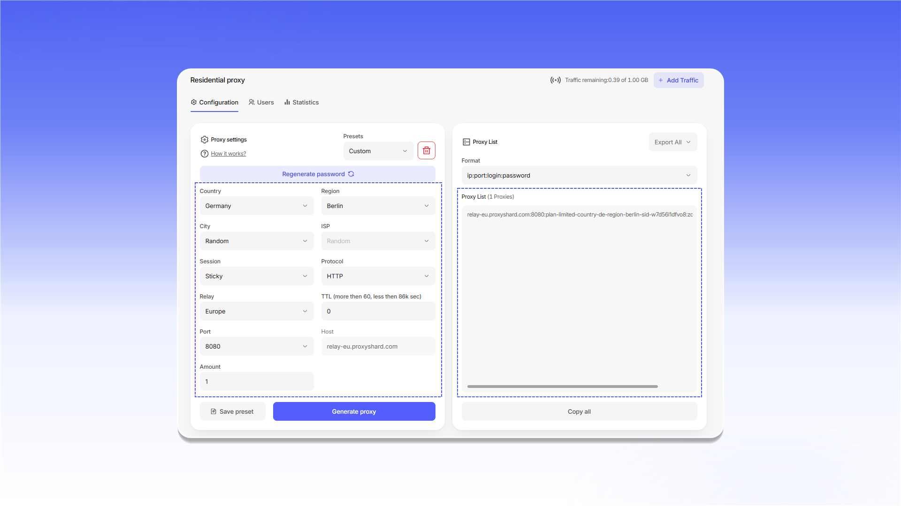
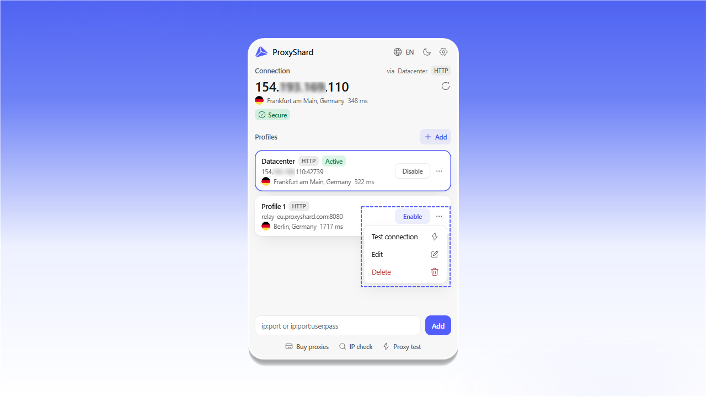
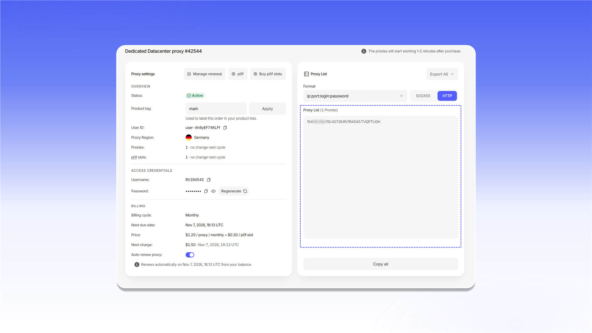
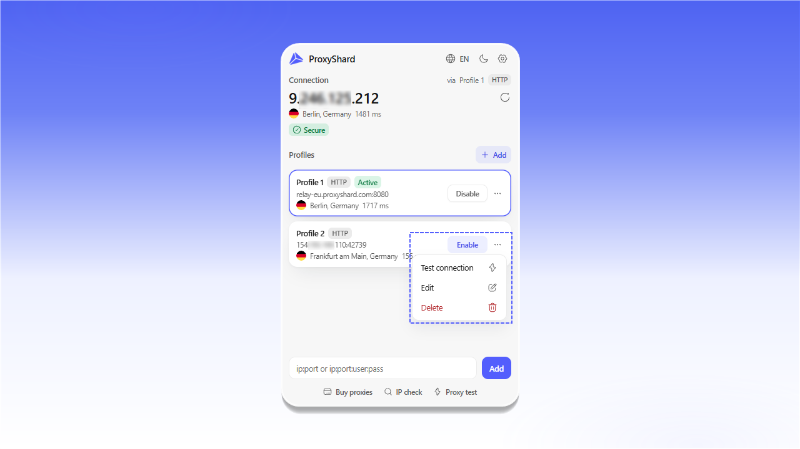

# ShardX Extension

<mark style="color:purple;">**ShardX – Smart Proxy Manager**</mark> - фирменное расширение ShardX для Chrome, Mozilla Firefox и браузеров на Chromium: Edge, Opera, Brave, Yandex и других. С его помощью можно добавлять, проверять и переключать прокси прямо в браузере.

#### Возможности расширения

* Неограниченное количество прокси-профилей
* HTTP / HTTPS во всех поддерживаемых браузерах
* SOCKS5 в версии для Mozilla Firefox
* Проверка подключения, IP-адреса, страны и задержки
* Ротация IP мобильного прокси по таймеру или сочетанию клавиш
* Правила маршрутизации и автоматическое переключение профилей по доменам
* Защита от утечки WebRTC и проверка TCP-отпечатка через p0f
* Импорт и экспорт профилей
* Интерфейс на английском, русском, украинском и китайском языках

<figure>
  <picture>
    <source srcset="../.gitbook/assets/proxyshard-extension-popup-overview_black.png" media="(prefers-color-scheme: dark)">
    
  </picture>
  <figcaption>
Главное окно расширения со списком прокси-профилей
</figcaption>
</figure>

## Установка расширения

Расширение доступно в официальных магазинах Chrome Web Store и Firefox Add-ons. Версия из Chrome Web Store также устанавливается в Edge, Opera, Brave и другие браузеры на Chromium.

### Chrome, Edge, Opera, Brave, Yandex и другие Chromium-браузеры



### Mozilla Firefox



После установки откройте меню `Extensions` справа от адресной строки и закрепите `ShardX – Smart Proxy Manager`, нажав значок булавки.

<figure>
  <picture>
    <source srcset="../.gitbook/assets/proxyshard-extension-pin_black.png" media="(prefers-color-scheme: dark)">
    
  </picture>
  <figcaption>
Откройте меню Extensions и закрепите расширение
</figcaption>
</figure>


**Ограничение SOCKS5 в браузерах на Chromium**

Chrome и другие браузеры на Chromium не поддерживают авторизацию по логину и паролю для SOCKS5-прокси через расширения Manifest V3.

SOCKS5 можно использовать только без учётных данных или с авторизацией по белому списку IP-адресов. Для прокси с логином и паролем выберите HTTP / HTTPS.



**SOCKS5 в Mozilla Firefox**

Версия ShardX Extension для Mozilla Firefox поддерживает SOCKS5 с авторизацией, поэтому такие профили можно использовать напрямую.


## Настройка резидентского прокси

1. Откройте заказ на странице [Residential proxy](https://dashboard.shardx.com/en/residential-main).
2. Укажите страну, регион, тип сессии, протокол и другие параметры, затем нажмите `Generate proxy`.
3. В блоке `Proxy List` выберите нужный формат и нажмите `Copy all`.

<figure>
  <picture>
    <source srcset="../.gitbook/assets/proxyshard-extension-residential-generate_black.png" media="(prefers-color-scheme: dark)">
    
  </picture>
  <figcaption>
Настройка резидентского прокси и блок Proxy List
</figcaption>
</figure>

4. Откройте закреплённое расширение ShardX.
5. Вставьте строку в формате `ip:port:login:password` в нижнее поле и нажмите `Add`.

<figure>
  <picture>
    <source srcset="../.gitbook/assets/proxyshard-extension-add-proxy-string_black.png" media="(prefers-color-scheme: dark)">
    
  </picture>
  <figcaption>
Вставьте строку подключения и нажмите Add
</figcaption>
</figure>

6. Новый профиль появится в списке. Откройте меню `...`, выберите `Test connection`, а после успешной проверки нажмите `Enable`.

<figure>
  <picture>
    <source srcset="../.gitbook/assets/proxyshard-extension-profile-actions_black.png" media="(prefers-color-scheme: dark)">
    
  </picture>
  <figcaption>
Меню проверки, редактирования и удаления профиля
</figcaption>
</figure>

## Настройка датацентр- или ISP-прокси

1. Откройте заказ датацентр- или ISP-прокси в личном кабинете.
2. В блоке `Proxy List` выберите протокол и формат, затем нажмите `Copy all`.

<figure>
  <picture>
    <source srcset="../.gitbook/assets/proxyshard-extension-datacenter-proxy-list_black.png" media="(prefers-color-scheme: dark)">
    
  </picture>
  <figcaption>
Скопируйте строку подключения из блока Proxy List
</figcaption>
</figure>

3. Откройте расширение, вставьте строку в нижнее поле и нажмите `Add`.

<figure>
  <picture>
    <source srcset="../.gitbook/assets/proxyshard-extension-add-datacenter-proxy_black.png" media="(prefers-color-scheme: dark)">
    
  </picture>
  <figcaption>
Добавление датацентр- или ISP-прокси
</figcaption>
</figure>

4. Откройте меню `...` у нового профиля и выберите `Test connection`.
5. Если проверка завершилась успешно, нажмите `Enable`. При включении другого профиля текущее подключение переключится автоматически.

<figure>
  <picture>
    <source srcset="../.gitbook/assets/proxyshard-extension-profile-switch_black.png" media="(prefers-color-scheme: dark)">
    
  </picture>
  <figcaption>
Проверка и включение нового профиля
</figcaption>
</figure>

## Ротация IP мобильного прокси

Откройте меню `...` у профиля, нажмите `Edit` и разверните блок `IP rotation`.

* `Enable IP rotation` включает автоматическую смену IP.
* В `Rotation URL` вставьте ссылку на смену IP из заказа мобильного прокси.
* В `Trigger` выберите `Hotkey` или `Interval`.
* Для `Hotkey` укажите сочетание клавиш, например `Shift+F2`. На внутренних страницах `chrome://` сочетание нужно назначить отдельно на странице `chrome://extensions/shortcuts`.
* Для `Interval` укажите интервал между запросами на смену IP.
* `Track IP history (detects duplicate IPs)` отслеживает повторное получение одного и того же IP-адреса.

Нажмите `Save profile`, чтобы сохранить настройки.

<figure>
  <picture>
    <source srcset="../.gitbook/assets/proxyshard-extension-edit-profile-ip-rotation_black.png" media="(prefers-color-scheme: dark)">
    
  </picture>
  <figcaption>
Ротация IP по сочетанию клавиш или интервалу
</figcaption>
</figure>

## Маршрутизация и автоматическое переключение

В окне редактирования профиля доступны блоки `Domain routing` и `Auto-switch`.

### Domain routing

Этот блок задаёт правила маршрутизации для отдельных доменов.

* `Enable routing rules` включает правила.
* `Whitelist` направляет через прокси только указанные домены.
* `Blacklist` исключает указанные домены из проксирования.
* В `Domains` укажите по одному домену в строке. Для включения поддоменов используйте маску `*.` перед доменом, например `*.google.com`.

### Auto-switch

Функция автоматически включает выбранный профиль при открытии указанных сайтов.

* `Enable auto-switch` включает автоматическое переключение.
* В `Activate on these domains` укажите по одному домену в строке, например `example.com` или `*.work-site.com`.

Нажмите `Save profile`, чтобы сохранить изменения, или `Cancel`, чтобы закрыть окно без сохранения.

<figure>
  <picture>
    <source srcset="../.gitbook/assets/proxyshard-extension-edit-profile-routing_black.png" media="(prefers-color-scheme: dark)">
    
  </picture>
  <figcaption>
Маршрутизация по доменам и автоматическое переключение профиля
</figcaption>
</figure>

## Ручное добавление профиля

1. Нажмите значок шестерёнки в главном окне расширения и откройте раздел `Profiles`.
2. Нажмите `+ Add profile` и выберите вкладку `Manual`.
3. Заполните поля:
   * `Name` - название профиля;
   * `Type` - тип подключения;
   * `Host` и `Port` - адрес и порт прокси-сервера;
   * `Bypass list` - адреса, которые должны открываться напрямую, по одному в строке;
   * `Username` и `Password` - данные авторизации.
4. При необходимости настройте `IP rotation`, `Domain routing` и `Auto-switch domains`.
5. Нажмите `Save profile`.

Для быстрого добавления готовой строки можно использовать вкладку `Quick paste`.

<figure>
  <picture>
    <source srcset="../.gitbook/assets/proxyshard-extension-options-add-profile_black.png" media="(prefers-color-scheme: dark)">
    
  </picture>
  <figcaption>
Форма Add profile во вкладке Manual
</figcaption>
</figure>

## Импорт и экспорт профилей

Раздел `Import and export` позволяет создать резервную копию профилей и восстановить её при необходимости.

* `Export profiles` сохраняет все профили в JSON-файл. Нажмите `Export JSON` и сохраните файл в безопасном месте.
* `Import from JSON` восстанавливает профили из ранее экспортированного файла. Нажмите `Import JSON` и выберите резервную копию.


Файл резервной копии может содержать адреса прокси и данные авторизации. Не передавайте его посторонним.


<figure>
  <picture>
    <source srcset="../.gitbook/assets/proxyshard-extension-options-import-export_black.png" media="(prefers-color-scheme: dark)">
    
  </picture>
  <figcaption>
Резервное копирование и восстановление профилей
</figcaption>
</figure>

## Дополнительные настройки

В разделе `Preferences` доступны следующие параметры:

* `Show IP widget in popup` показывает текущий IP-адрес и локацию в верхней части окна расширения.
* `Show badge on the toolbar icon` показывает индикатор состояния на значке расширения.
* `Context menu` добавляет переключение прокси-профилей в контекстное меню браузера.
* `Auto-switch by domain` разрешает автоматическое включение профиля для настроенных доменов.
* `WebRTC leak protection` помогает защитить реальный IP-адрес от утечки через WebRTC. При включённой защите некоторые сервисы, использующие WebRTC, могут работать некорректно. Подробнее о технологии читайте в разделе [UDP и WebRTC](about-udp/README.md).
* `Proxy fingerprint check (p0f)` сравнивает операционную систему из User-Agent с TCP-отпечатком. Несовпадение может указывать на использование прокси. Подробнее читайте в разделе [Подмена отпечатка ОС через p0f](p0f-spoofing.md).
* `IP checker` позволяет выбрать сервис для определения IP-адреса и локации. В режиме `Auto (fallback)` расширение последовательно проверяет доступные сервисы, пока один из них не ответит.

После изменения параметров нажмите `Save preferences`.

<figure>
  <picture>
    <source srcset="../.gitbook/assets/proxyshard-extension-options-preferences_black.png" media="(prefers-color-scheme: dark)">
    
  </picture>
  <figcaption>
Дополнительные настройки расширения
</figcaption>
</figure>


ShardX Extension готово к работе. Включать и переключать сохранённые профили можно из главного окна расширения.

