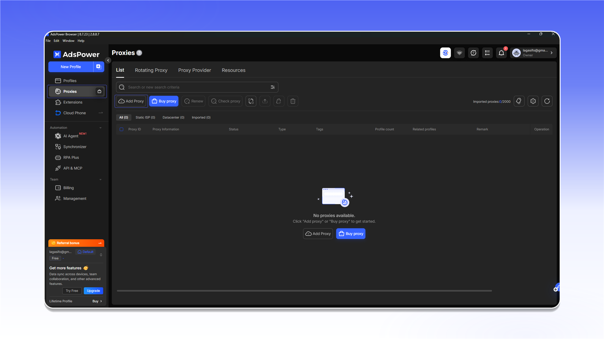
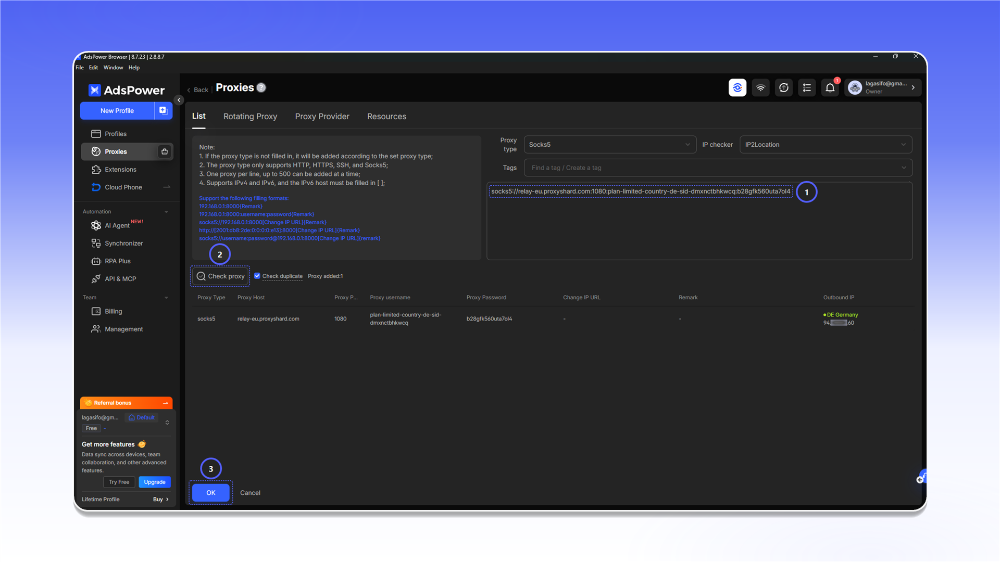
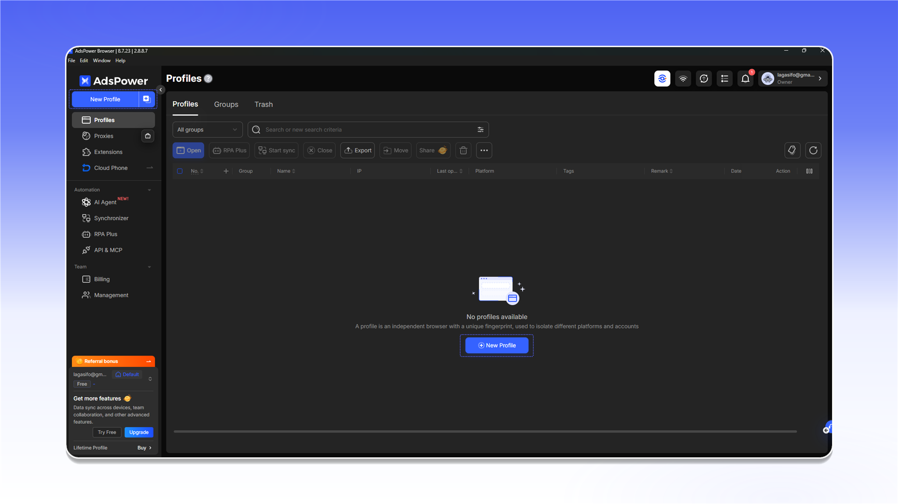
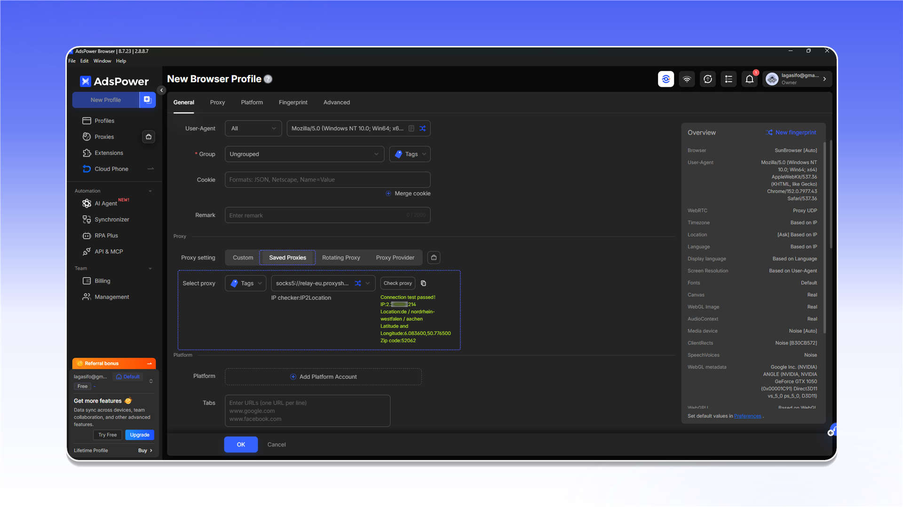

# AdsPower


AdsPower не поддерживает UDP-прокси. Для задач с UDP используйте [Vision Browser](vision-browser.md).


## Добавление прокси

Откройте раздел `Proxies` и нажмите `Add Proxy`.

<figure>
  <picture>
    <source srcset="../../.gitbook/assets/adspower-proxies-add-proxy_black.png" media="(prefers-color-scheme: dark)">
    
  </picture>
</figure>

1. Скопируйте строку подключения из `Proxy List` нужного заказа и вставьте её в поле формы.
2. Нажмите `Check proxy`.
3. После успешной проверки нажмите `OK`.

<figure>
  <picture>
    <source srcset="../../.gitbook/assets/adspower-add-proxy-form_black.png" media="(prefers-color-scheme: dark)">
    
  </picture>
</figure>


Расположение данных подключения описано в [общей инструкции](../getting-started.md).


Если проверка не проходит, проверьте логин, пароль и протокол. Затем протестируйте подключение через [Proxy Tester](../../our-products/proxy-tester.md).

<figure>
  <picture>
    <source srcset="../../.gitbook/assets/adspower-proxy-tester-result_black.png" media="(prefers-color-scheme: dark)">
    
  </picture>
</figure>

## Назначение прокси профилю

Откройте `Profiles` и нажмите `New Profile`.

<figure>
  <picture>
    <source srcset="../../.gitbook/assets/adspower-profiles-new-profile_black.png" media="(prefers-color-scheme: dark)">
    
  </picture>
</figure>

В настройках профиля выберите добавленный сервер в `Saved Proxies`, выполните проверку и сохраните профиль.

<figure>
  <picture>
    <source srcset="../../.gitbook/assets/adspower-new-profile-saved-proxy_black.png" media="(prefers-color-scheme: dark)">
    
  </picture>
</figure>
