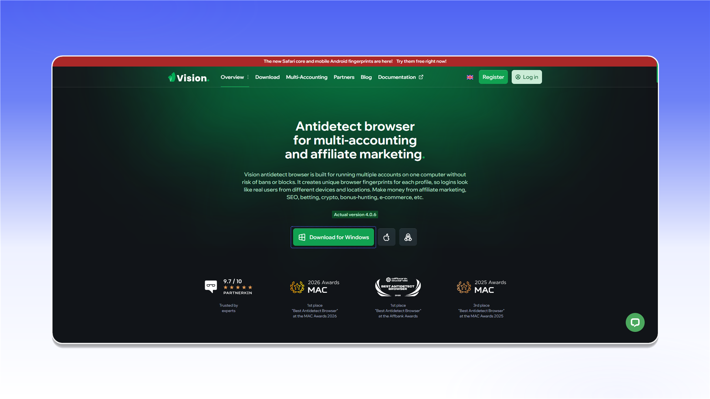
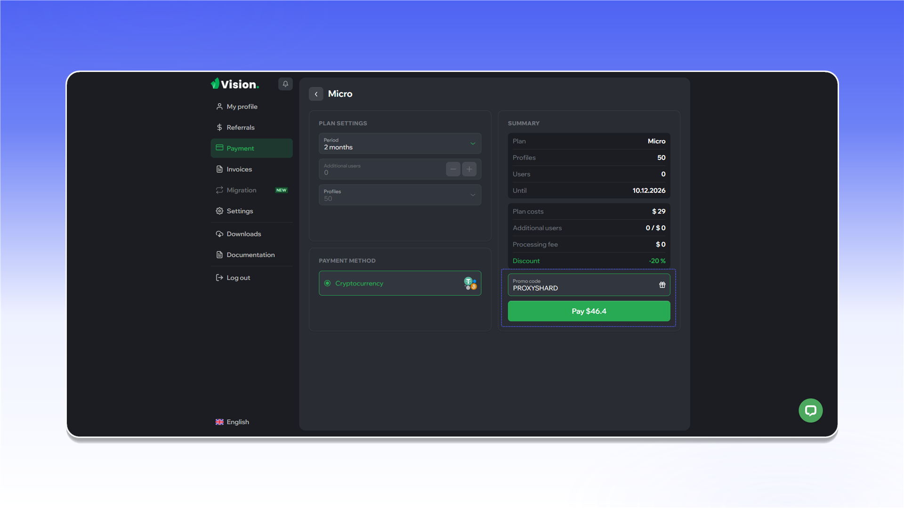
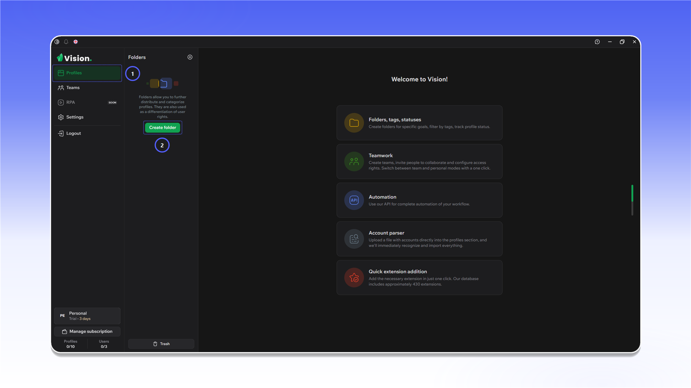
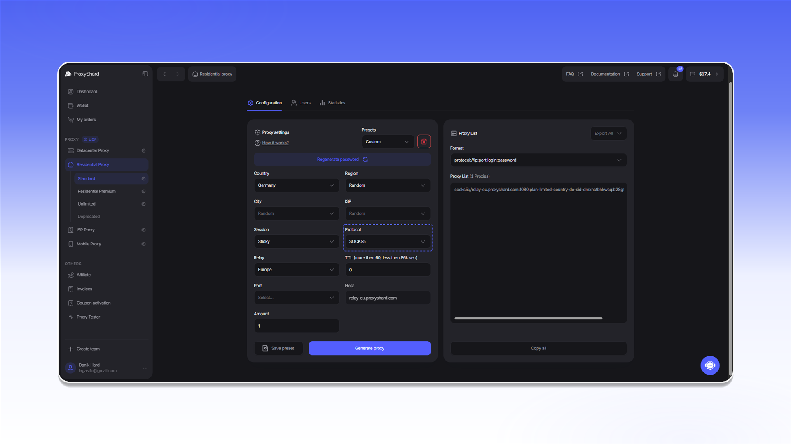
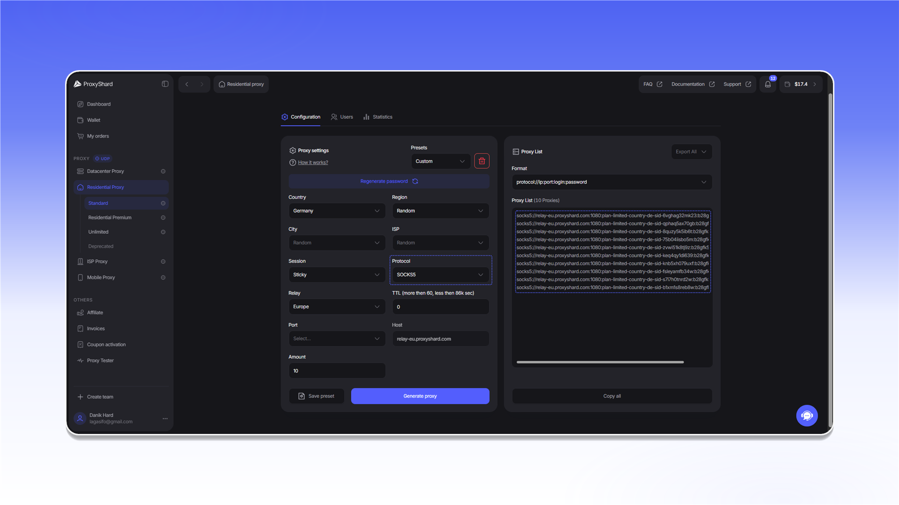
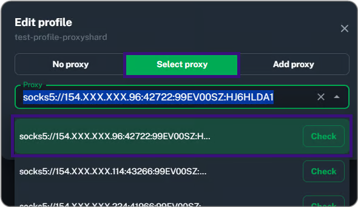

# Vision Browser


Vision Browser поддерживает TCP- и UDP-трафик через SOCKS5-прокси.


## Установка и регистрация

Откройте [сайт Vision Browser](https://browser.vision/r/ecf2408f-02de-4e4f-bc24-be368ac32325), скачайте приложение и установите его.

<figure>
  <picture>
    <source srcset="../../.gitbook/assets/vision-website-download_black.png" media="(prefers-color-scheme: dark)">
    
  </picture>
</figure>

Создайте аккаунт. Эти данные потребуются для входа в приложение.

<figure>
  <picture>
    <source srcset="../../.gitbook/assets/vision-sign-up_black.png" media="(prefers-color-scheme: dark)">
    
  </picture>
</figure>

При оплате тарифа можно использовать промокод `PROXYSHARD` со скидкой 20%.

<figure>
  <picture>
    <source srcset="../../.gitbook/assets/vision-plan-promo-code_black.png" media="(prefers-color-scheme: dark)">
    
  </picture>
</figure>

## Создание первого профиля

1. Откройте `Profiles`.
2. Перейдите в `Folders` и нажмите `Create folder`.

<figure>
  <picture>
    <source srcset="../../.gitbook/assets/vision-folders-create_black.png" media="(prefers-color-scheme: dark)">
    
  </picture>
</figure>

Укажите название папки и сохраните её.

<figure>
  <picture>
    <source srcset="../../.gitbook/assets/vision-folder-create-form_black.png" media="(prefers-color-scheme: dark)">
    
  </picture>
</figure>

В созданной папке нажмите `Create profile`.

<figure>
  <picture>
    <source srcset="../../.gitbook/assets/vision-profiles-create-profile_black.png" media="(prefers-color-scheme: dark)">
    
  </picture>
</figure>

В панели ProxyShard сгенерируйте один прокси в формате SOCKS5 и скопируйте данные подключения.

<figure>
  <picture>
    <source srcset="../../.gitbook/assets/vision-residential-generate-single_black.png" media="(prefers-color-scheme: dark)">
    
  </picture>
</figure>

В настройках профиля Vision откройте вкладку `SOCKS`, вставьте данные прокси, проверьте соединение и нажмите `Save`.

<figure>
  <picture>
    <source srcset="../../.gitbook/assets/vision-create-profile-socks_black.png" media="(prefers-color-scheme: dark)">
    
  </picture>
</figure>

<figure><figcaption></figcaption></figure>

## Добавление списка прокси

Откройте вкладку `Proxies` и нажмите `Add proxy`.

<figure>
  <picture>
    <source srcset="../../.gitbook/assets/vision-proxies-add-proxy_black.png" media="(prefers-color-scheme: dark)">
    
  </picture>
</figure>

В панели ProxyShard сгенерируйте список прокси в формате SOCKS5 и скопируйте его.

<figure>
  <picture>
    <source srcset="../../.gitbook/assets/vision-residential-generate-list_black.png" media="(prefers-color-scheme: dark)">
    
  </picture>
</figure>

Вставьте список в поле добавления. После импорта убедитесь, что подключения имеют статус `Online`.

<figure>
  <picture>
    <source srcset="../../.gitbook/assets/vision-proxies-imported-list_black.png" media="(prefers-color-scheme: dark)">
    
  </picture>
</figure>

Чтобы назначить прокси существующему профилю, нажмите значок в столбце `Proxy`.

<figure><figcaption></figcaption></figure>

Выберите `Select proxy`, укажите нужное подключение и выполните проверку.

<figure><figcaption></figcaption></figure>

После сохранения прокси появится в строке профиля.

<figure><figcaption></figcaption></figure>

## Проверка WebRTC

Запустите профиль и откройте [ProxyShard IP Checker](https://proxyshard.com/ip-checker). Адреса TCP и WebRTC должны совпадать.

<figure>
  <picture>
    <source srcset="../../.gitbook/assets/vision-webrtc-check_black.png" media="(prefers-color-scheme: dark)">
    
  </picture>
</figure>
