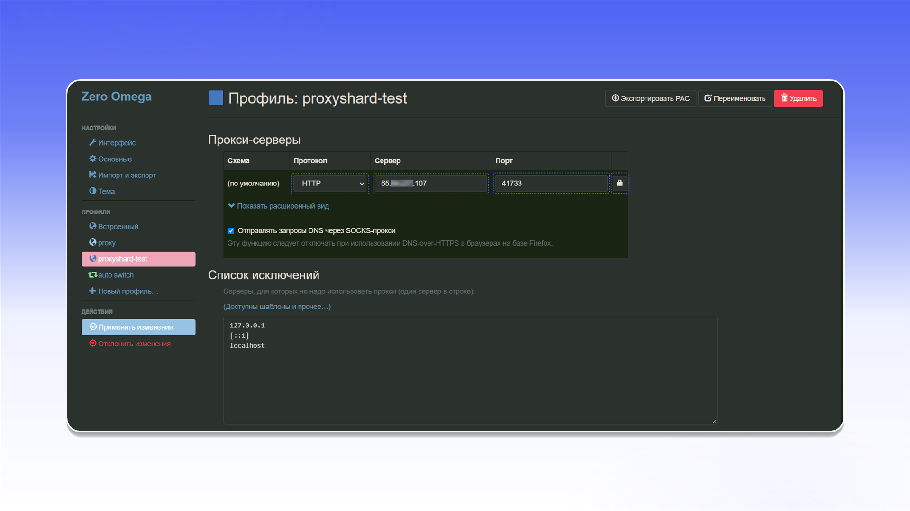
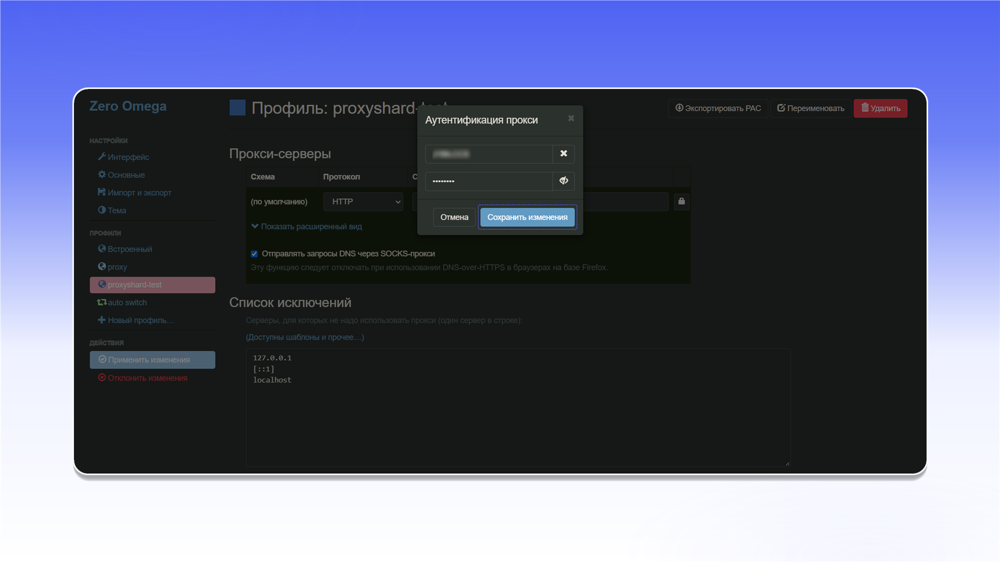
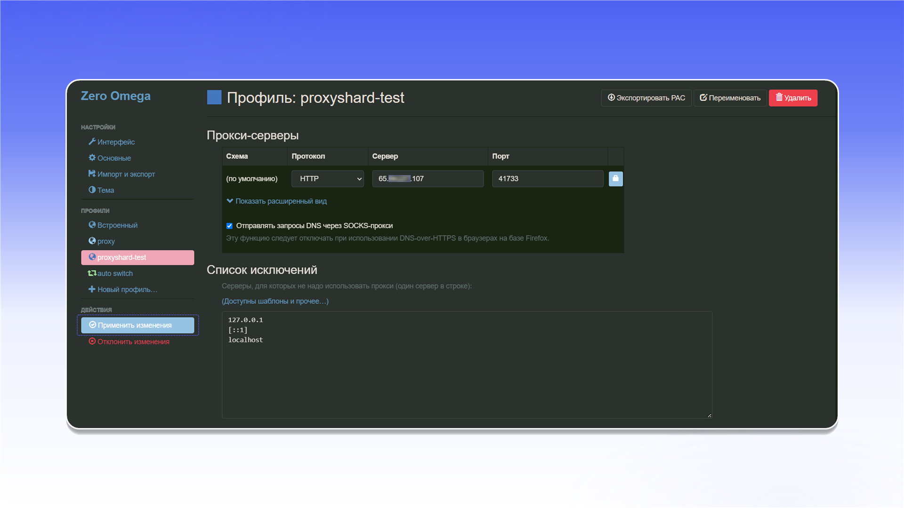

# ZeroOmega

## **Установка и настройка** ZeroOmega


Данное решение не поддерживает туннелирование по UDP! Крайне советуем рассмотреть для этих целей [<mark style="color:green;">Vision</mark>](../../antidetect-browsers/vision-browser.md)


Для браузера Chrome есть расширение [**ZeroOmega**](https://chromewebstore.google.com/detail/Proxy%20SwitchyOmega%203%20\(ZeroOmega\)/pfnededegaaopdmhkdmcofjmoldfiped)**,** произведите его установку

{% embed url="https://chromewebstore.google.com/detail/Proxy%20SwitchyOmega%203%20(ZeroOmega)/pfnededegaaopdmhkdmcofjmoldfiped" %}

После установки расширения, у вас справа сверху станет доступно установленное расширение, нажмите на него и для удобства пользования, закрепите расширение.

<figure><figcaption></figcaption></figure>

\
Откройте параметры расширения.

<figure>
  <picture>
    <source srcset="../../../.gitbook/assets/chrome-zeroomega-open-options_black.png" media="(prefers-color-scheme: dark)">
    
  </picture>
</figure>

## **Настройка прокси в расширении**

В интерфейсе настройки Zero Omega создайте новый профиль и присвойте ему любое имя

<figure>
  <picture>
    <source srcset="../../../.gitbook/assets/chrome-zeroomega-new-profile_black.png" media="(prefers-color-scheme: dark)">
    
  </picture>
</figure>

Тут укажите произвольное имя профиля

<figure>
  <picture>
    <source srcset="../../../.gitbook/assets/chrome-zeroomega-new-profile-dialog_black.png" media="(prefers-color-scheme: dark)">
    
  </picture>
</figure>

Далее откроется интерфейс настройки серверов, тут вам необходимо взять из заказа в "Proxy list" сами прокси и вручную вставить IP сервера, порт, логин и пароль.

\
Логин и пароль задаются кнопкой со значком замка 🔒.


**С примером настройки прокси вы можете ознакомиться в разделе [Инструкция по настройке](../../getting-started.md)**


<figure>
  <picture>
    <source srcset="../../../.gitbook/assets/chrome-zeroomega-proxy-server_black.png" media="(prefers-color-scheme: dark)">
    
  </picture>
</figure>

Тут необходимо вставить логин и пароль прокси.

<figure>
  <picture>
    <source srcset="../../../.gitbook/assets/chrome-zeroomega-proxy-auth_black.png" media="(prefers-color-scheme: dark)">
    
  </picture>
</figure>

Затем примените настройки 

<figure>
  <picture>
    <source srcset="../../../.gitbook/assets/chrome-zeroomega-apply-changes_black.png" media="(prefers-color-scheme: dark)">
    
  </picture>
</figure>

В сплывающем окне выберите прокси которые вы ранее настроили

<figure><figcaption></figcaption></figure>

**Готово! Вы закончили настройку прокси через расширение в Chrome.**\
**Теперь вы можете приступить к использованию прокси.**
