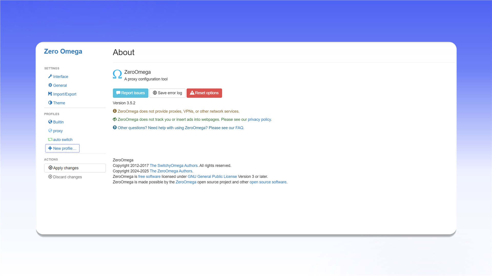
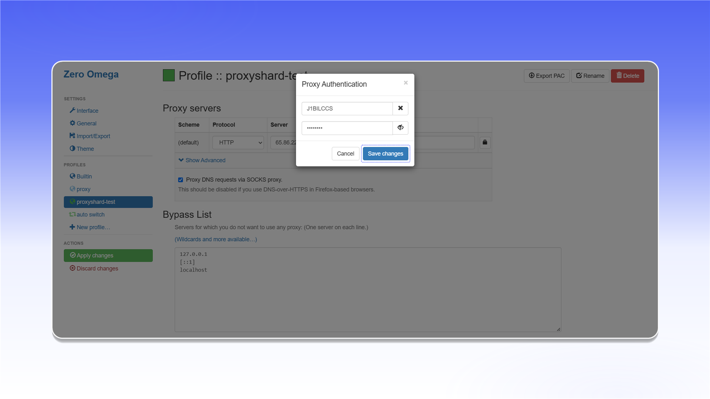
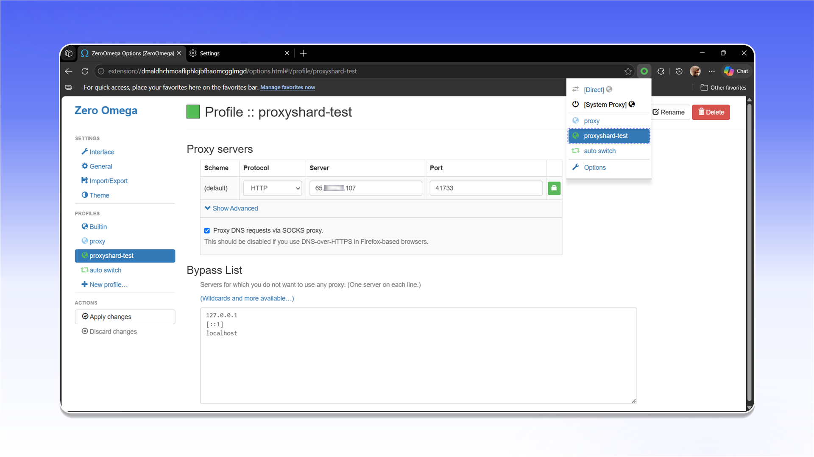

# ZeroOmega

## **Установка** ZeroOmega Edge


Данное решение не поддерживает туннелирование по UDP! Крайне советуем рассмотреть для этих целей [<mark style="color:green;">Vision</mark>](../../antidetect-browsers/vision-browser.md)


Так как Edge поддерживает Chrome-расширения, мы рекомендуем воспользоваться **ZeroOmega**

Для браузера Edge есть расширение [**ZeroOmega**](https://microsoftedge.microsoft.com/addons/detail/proxy-switchyomega-3-zer/dmaldhchmoafliphkijbfhaomcgglmgd)**,** произведите его установку



<figure>
  <picture>
    <source srcset="../../../.gitbook/assets/edge-zeroomega-addons-get_black.png" media="(prefers-color-scheme: dark)">
    
  </picture>
</figure>

После установки расширения, у вас справа сверху станет доступно установленное расширение, нажмите на него и для удобства пользования, закрепите расширение.

<figure><figcaption></figcaption></figure>

## Настройка ZeroOmega

Откройте параметры расширения.

<figure><figcaption></figcaption></figure>

В интерфейсе настройки Zero Omega создайте новый профиль и присвойте ему любое имя

<figure>
  <picture>
    <source srcset="../../../.gitbook/assets/edge-zeroomega-new-profile_black.png" media="(prefers-color-scheme: dark)">
    
  </picture>
</figure>

Тут укажите произвольное имя профиля

<figure>
  <picture>
    <source srcset="../../../.gitbook/assets/edge-zeroomega-new-profile-dialog_black.png" media="(prefers-color-scheme: dark)">
    
  </picture>
</figure>

Далее откроется интерфейс настройки серверов, тут вам необходимо взять из заказа в "Proxy list" сами прокси и вручную вставить IP (или DNS) сервера, порт, логин и пароль.\
Логин и пароль задаются в кнопке со значком замка 🔒.

<figure>
  <picture>
    <source srcset="../../../.gitbook/assets/edge-zeroomega-proxy-server_black.png" media="(prefers-color-scheme: dark)">
    
  </picture>
</figure>

Тут необходимо вставить логин и пароль прокси.

<figure>
  <picture>
    <source srcset="../../../.gitbook/assets/edge-zeroomega-proxy-auth_black.png" media="(prefers-color-scheme: dark)">
    
  </picture>
</figure>


**С примером настройки прокси вы можете ознакомиться в разделе [Инструкция по настройке](../../getting-started.md)**


Затем примените настройки 

<figure>
  <picture>
    <source srcset="../../../.gitbook/assets/edge-zeroomega-apply-changes_black.png" media="(prefers-color-scheme: dark)">
    
  </picture>
</figure>

7\) В сплывающем окне выберите прокси которые вы ранее настроили

<figure>
  <picture>
    <source srcset="../../../.gitbook/assets/edge-zeroomega-select-profile_black.png" media="(prefers-color-scheme: dark)">
    
  </picture>
</figure>

**Готово! Вы закончили настройку прокси через расширение.**\
**Теперь вы можете приступить к использованию наших прокси.**
