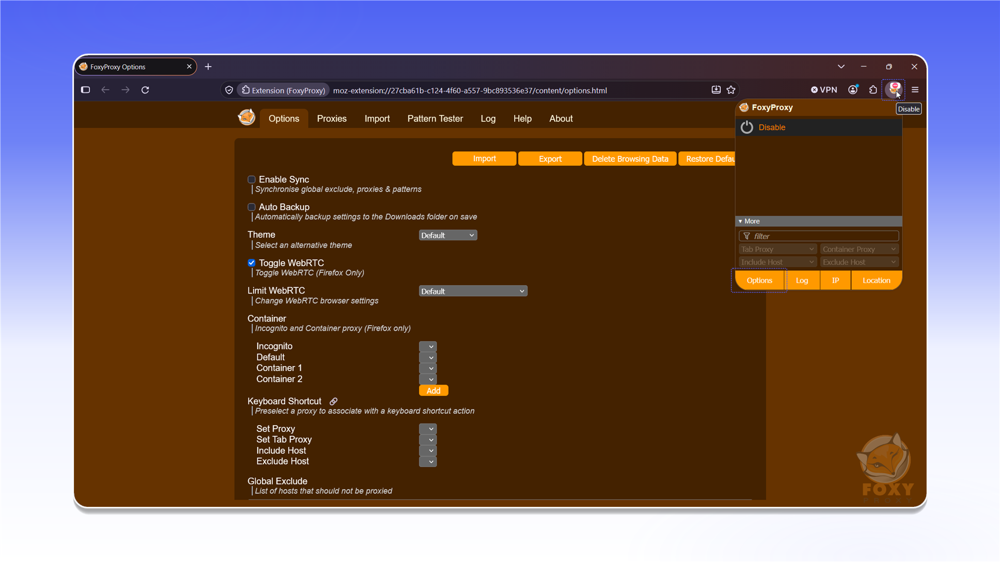
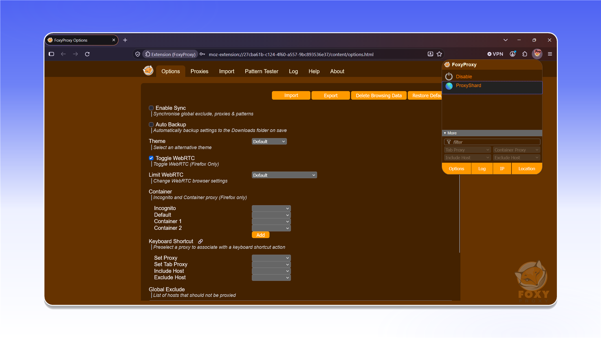

# FoxyProxy

## Установка расширения FoxyProxy


FoxyProxy работает только с TCP-трафиком.


Установите [FoxyProxy Standard](https://addons.mozilla.org/firefox/addon/foxyproxy-standard/) из Firefox Add-ons.



<figure>
  <picture>
    <source srcset="../../../.gitbook/assets/foxyproxy-addon-page_black.png" media="(prefers-color-scheme: dark)">
    
  </picture>
</figure>

После установки откройте FoxyProxy и перейдите в настройки расширения.

<figure>
  <picture>
    <source srcset="../../../.gitbook/assets/foxyproxy-options-popup-disable_black.png" media="(prefers-color-scheme: dark)">
    
  </picture>
</figure>

## Настройка прокси

Откройте раздел `Proxies` и нажмите `Add`.

<figure>
  <picture>
    <source srcset="../../../.gitbook/assets/foxyproxy-add-proxy-form_black.png" media="(prefers-color-scheme: dark)">
    
  </picture>
</figure>


Формат данных и пример заказа описаны в разделе [Начало работы](../../getting-started.md).


Укажите название профиля в поле `Title`. Затем выберите тип прокси и заполните поля `Hostname`, `Port`, `Username` и `Password` данными из `Proxy List` вашего заказа. Нажмите `Save`.

<figure>
  <picture>
    <source srcset="../../../.gitbook/assets/foxyproxy-proxy-config-filled_black.png" media="(prefers-color-scheme: dark)">
    
  </picture>
</figure>

## Подключение

Откройте FoxyProxy и выберите созданный профиль.

<figure>
  <picture>
    <source srcset="../../../.gitbook/assets/foxyproxy-options-popup-proxyshard_black.png" media="(prefers-color-scheme: dark)">
    
  </picture>
</figure>

Прокси подключён и готов к работе в Mozilla Firefox.
