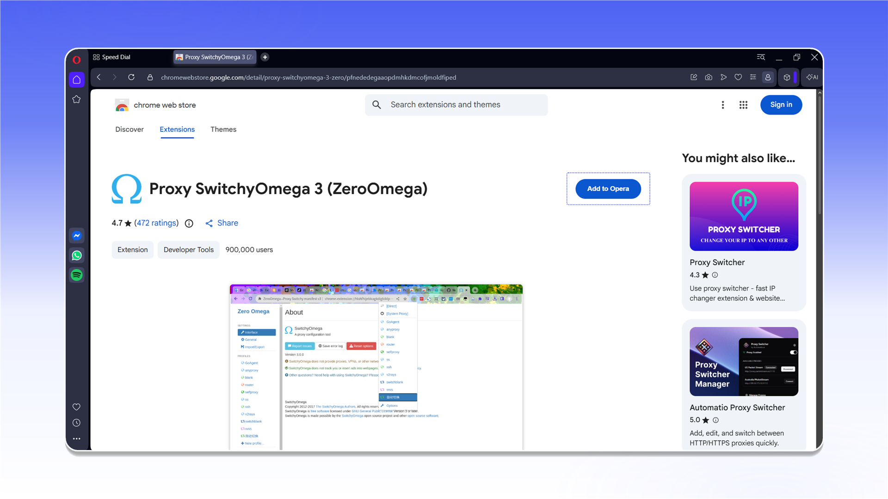
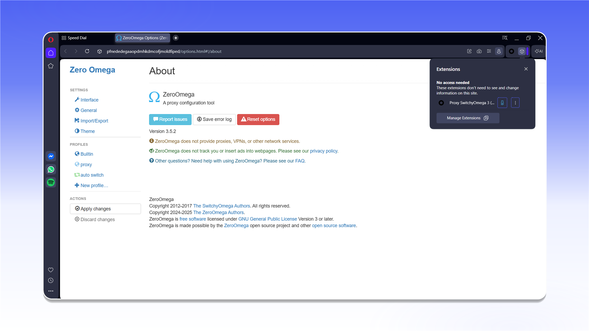
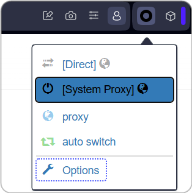
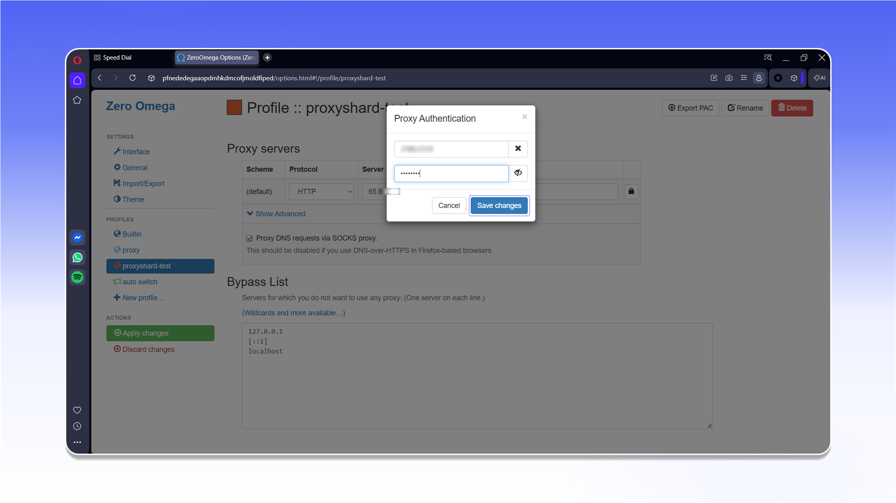
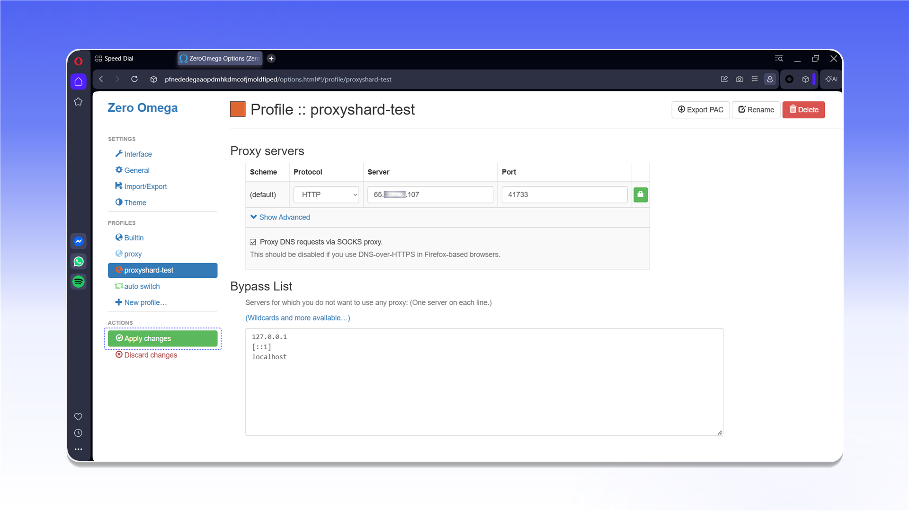

# ZeroOmega

## Установка ZeroOmega


ZeroOmega работает только с TCP-трафиком. Для работы с UDP используйте [Vision Browser](../../antidetect-browsers/vision-browser.md).


Установите [ZeroOmega](https://chromewebstore.google.com/detail/pfnededegaaopdmhkdmcofjmoldfiped) из Chrome Web Store.



<figure>
  <picture>
    <source srcset="../../../.gitbook/assets/opera-zeroomega-web-store_black.png" media="(prefers-color-scheme: dark)">
    
  </picture>
</figure>

После установки откройте меню расширений и закрепите ZeroOmega на панели браузера.

<figure>
  <picture>
    <source srcset="../../../.gitbook/assets/opera-zeroomega-extensions-menu_black.png" media="(prefers-color-scheme: dark)">
    
  </picture>
</figure>

Откройте ZeroOmega и выберите `Options`.

<figure><figcaption></figcaption></figure>

В разделе `Profiles` нажмите `New profile...`.

<figure>
  <picture>
    <source srcset="../../../.gitbook/assets/opera-zeroomega-new-profile_black.png" media="(prefers-color-scheme: dark)">
    
  </picture>
</figure>

Введите название профиля, выберите `Proxy Profile` и нажмите `Create`.

<figure>
  <picture>
    <source srcset="../../../.gitbook/assets/opera-zeroomega-new-profile-dialog_black.png" media="(prefers-color-scheme: dark)">
    
  </picture>
</figure>

В настройках профиля выберите протокол и укажите адрес сервера и порт из `Proxy List` вашего заказа. Чтобы добавить логин и пароль, нажмите значок замка.

<figure>
  <picture>
    <source srcset="../../../.gitbook/assets/opera-zeroomega-proxy-server_black.png" media="(prefers-color-scheme: dark)">
    
  </picture>
</figure>

Введите логин и пароль прокси, затем подтвердите изменения.

<figure>
  <picture>
    <source srcset="../../../.gitbook/assets/opera-zeroomega-proxy-auth_black.png" media="(prefers-color-scheme: dark)">
    
  </picture>
</figure>


Формат данных и пример заказа описаны в разделе [Начало работы](../../getting-started.md).


Нажмите `Apply changes`, чтобы сохранить профиль.

<figure>
  <picture>
    <source srcset="../../../.gitbook/assets/opera-zeroomega-apply-changes_black.png" media="(prefers-color-scheme: dark)">
    
  </picture>
</figure>

Откройте ZeroOmega на панели браузера и выберите созданный профиль.

<figure>
  <picture>
    <source srcset="../../../.gitbook/assets/opera-zeroomega-profile-active_black.png" media="(prefers-color-scheme: dark)">
    
  </picture>
</figure>

Прокси подключён и готов к работе в Opera.
