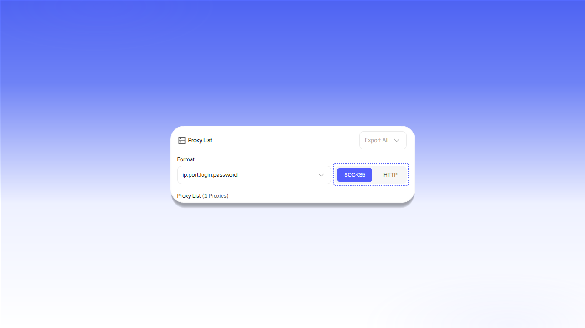

# Инструкция по настройке

Перед настройкой программы откройте нужный [заказ](https://dashboard.shardx.com/products) и подготовьте данные подключения.


В примерах ниже используется `SOCKS5`. Для датацентровых и ISP-прокси HTTP и SOCKS5 работают на одном порту. Переключатель HTTP / SOCKS5 в заказе меняет только формат отображаемой строки и оставлен для совместимости со старыми настройками. В программе выберите нужный протокол и используйте порт, указанный в заказе.


## Резидентские прокси

1. В блоке `Proxy settings` выберите страну и задайте параметры сессии: `Session`, `Relay` и `Protocol`.
2. Нажмите `Generate proxy`.
3. Скопируйте готовую строку из блока `Proxy List`.

<figure>
  <picture>
    <source srcset="../.gitbook/assets/residential-proxy-setup_black.png" media="(prefers-color-scheme: dark)">
    
  </picture>
</figure>

## Датацентр- и ISP-прокси

Откройте заказ и скопируйте строку подключения из блока `Proxy List`.

<figure>
  <picture>
    <source srcset="../.gitbook/assets/static-proxy-setup_black.png" media="(prefers-color-scheme: dark)">
    
  </picture>
</figure>

## Формат строки подключения

Стандартный формат: `server:port:login:password`.

<figure>
  <picture>
    <source srcset="../.gitbook/assets/proxy-format-breakdown_black.png" media="(prefers-color-scheme: dark)">
    
  </picture>
</figure>

| Поле | Описание |
|---|---|
| `Server / Host` | IP-адрес или домен прокси-сервера |
| `Port` | Порт подключения |
| `Login` | Имя пользователя. Для резидентских прокси оно также может содержать параметры таргетинга |
| `Password` | Пароль доступа |

Если программа не поддерживает вставку всей строки, заполните эти поля отдельно.

## Выбор протокола

Для датацентр- и ISP-прокси переключите формат в блоке `Proxy List`.

<figure>
  <picture>
    <source srcset="../.gitbook/assets/proxy-protocol-toggle_black.png" media="(prefers-color-scheme: dark)">
    
  </picture>
</figure>

Для резидентских прокси выберите протокол в поле `Protocol` перед генерацией строки.

<figure>
  <picture>
    <source srcset="../.gitbook/assets/proxy-protocol-select_black.png" media="(prefers-color-scheme: dark)">
    
  </picture>
</figure>

Мобильные прокси принимают HTTP- и SOCKS5-подключения на выданном порту. Дополнительно переключать формат в заказе не требуется.
