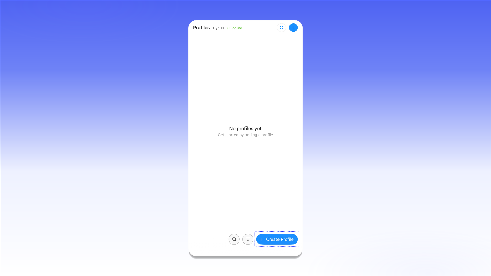
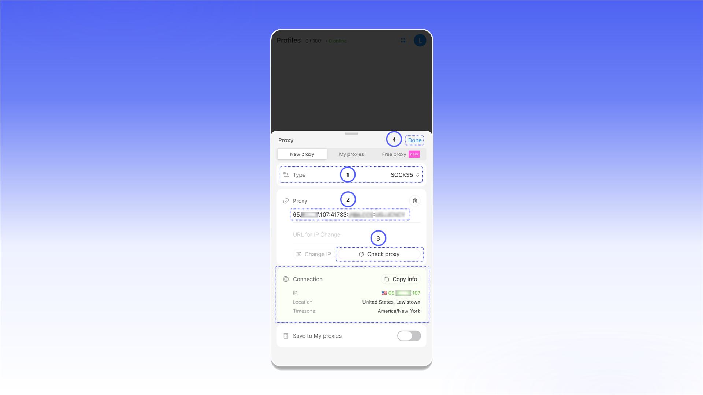
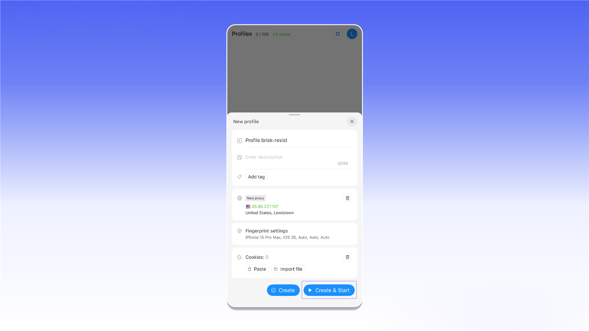

# Octo Browser


Прокси работает только внутри запущенного профиля Octo Browser. Другие приложения на устройстве продолжают использовать обычное интернет-соединение.


## Установка Octo Browser

Скачайте Octo Browser из App Store или Google Play.





## Регистрация и вход

Создайте аккаунт с помощью электронной почты или кнопки **Sign up with Apple**.

<figure>
  <picture>
    <source srcset="../../.gitbook/assets/octo-browser-ios-log-in_black.png" media="(prefers-color-scheme: dark)">
    
  </picture>
</figure>

После регистрации войдите в аккаунт тем же способом.

## Создание профиля с прокси

На экране **Profiles** нажмите **Create Profile**.

<figure>
  <picture>
    <source srcset="../../.gitbook/assets/octo-browser-ios-create-profile_black.png" media="(prefers-color-scheme: dark)">
    
  </picture>
</figure>

В настройках нового профиля нажмите **Set a proxy**.

<figure>
  <picture>
    <source srcset="../../.gitbook/assets/octo-browser-ios-set-proxy_black.png" media="(prefers-color-scheme: dark)">
    
  </picture>
</figure>

1. В поле **Type** выберите HTTP, HTTPS или SOCKS5.
2. Скопируйте строку подключения из нужного заказа ProxyShard и полностью вставьте её в поле **Proxy**.
3. Нажмите **Check proxy**. После успешной проверки приложение покажет IP-адрес, локацию и часовой пояс подключения.
4. Нажмите **Done**.

<figure>
  <picture>
    <source srcset="../../.gitbook/assets/octo-browser-ios-proxy-form_black.png" media="(prefers-color-scheme: dark)">
    
  </picture>
</figure>

## Запуск профиля

Нажмите **Create & Start**, чтобы сохранить профиль и сразу запустить его.

<figure>
  <picture>
    <source srcset="../../.gitbook/assets/octo-browser-ios-profile-ready_black.png" media="(prefers-color-scheme: dark)">
    
  </picture>
</figure>

Готово. Трафик этого профиля Octo Browser будет направляться через добавленный прокси.
