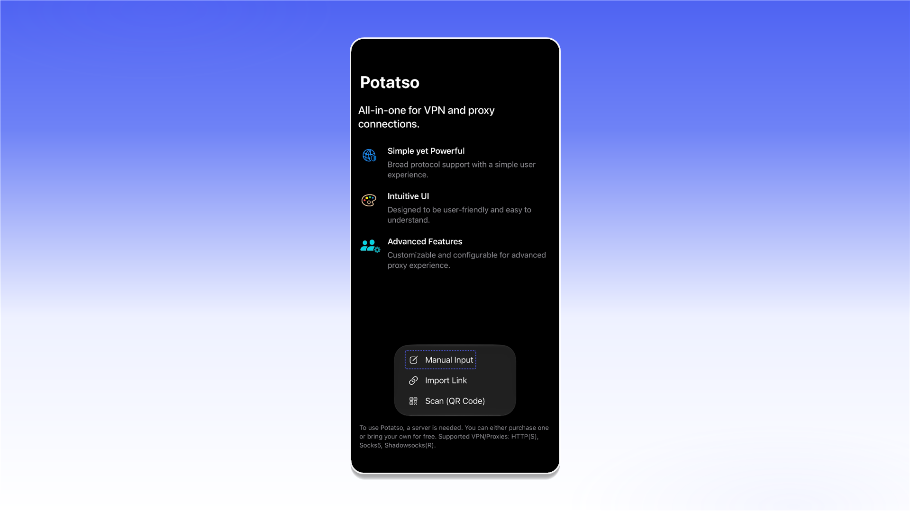

# Potatso

## Установка Potatso

Установите Potatso из App Store.



## Настройка Potatso

Откройте приложение и нажмите `Add Servers`.

<figure>
  <picture>
    <source srcset="../../.gitbook/assets/potatso-ios-add-servers_black.png" media="(prefers-color-scheme: dark)">
    
  </picture>
</figure>

Выберите `Manual Input`.

<figure>
  <picture>
    <source srcset="../../.gitbook/assets/potatso-ios-manual-input_black.png" media="(prefers-color-scheme: dark)">
    
  </picture>
</figure>

## Настройка профиля

Выберите тип подключения и заполните форму данными из `Proxy List` вашего заказа:

1. Укажите адрес сервера и порт.
2. Введите логин и пароль.
3. Сохраните конфигурацию.

<figure>
  <picture>
    <source srcset="../../.gitbook/assets/potatso-ios-add-server-form_black.png" media="(prefers-color-scheme: dark)">
    
  </picture>
</figure>


Формат данных и пример заказа описаны в разделе [Начало работы](../getting-started.md).


Выберите созданную конфигурацию и включите подключение.

<figure>
  <picture>
    <source srcset="../../.gitbook/assets/potatso-ios-connect_black.png" media="(prefers-color-scheme: dark)">
    
  </picture>
</figure>

Прокси подключён и готов к работе в Potatso.
