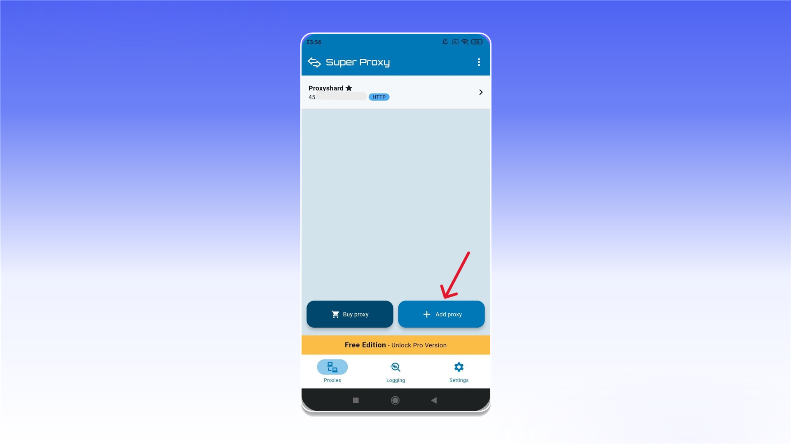

# Super Proxy

## Настройка Super Proxy

Скачайте приложение через ссылку:



## Создание профиля

Затем откройте приложение и добавьте прокси через "<mark style="color:purple;">Add proxy</mark>"

<figure>
  <picture>
    <source srcset="../../.gitbook/assets/super-proxy-android-add-proxy_black.png" media="(prefers-color-scheme: dark)">
    
  </picture>
</figure>

Из заказа установите прокси в соотвествующие поля и укажите тип протокола подключения

<figure>
  <picture>
    <source srcset="../../.gitbook/assets/super-proxy-android-proxy-form_black.png" media="(prefers-color-scheme: dark)">
    
  </picture>
</figure>


**С примером настройки прокси вы можете ознакомиться в разделе [Инструкция по настройке](../getting-started.md)**


Сохраните настройки и запустите программу

<figure>
  <picture>
    <source srcset="../../.gitbook/assets/super-proxy-android-start_black.png" media="(prefers-color-scheme: dark)">
    
  </picture>
</figure>

**Готово! Вы закончили настройку прокси через приложение "Super Proxy".**\
**Теперь вы можете приступить к использованию наших прокси.**
