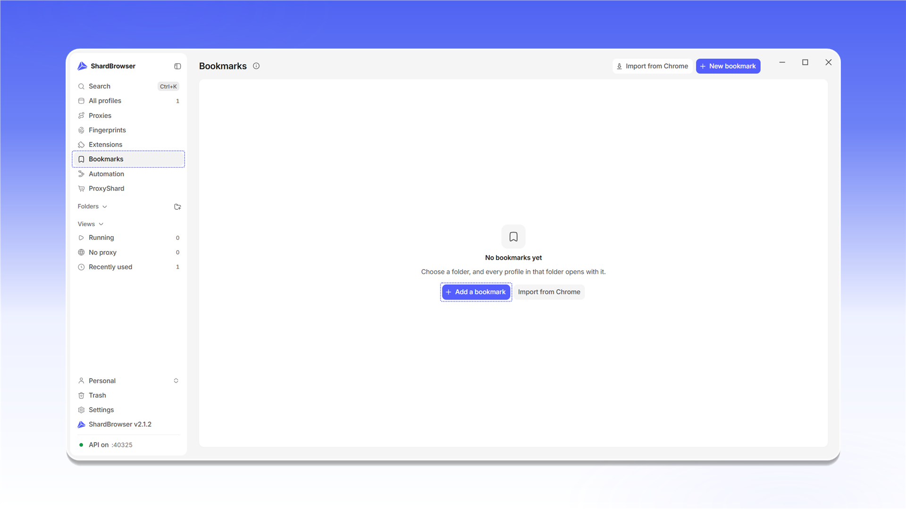
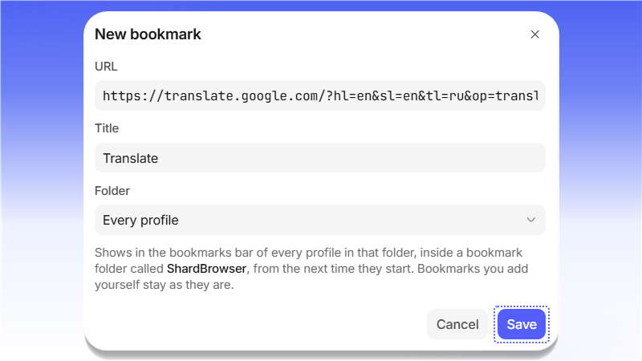

# Bookmarks

Раздел <mark style="color:purple;">**Bookmarks**</mark> позволяет один раз задать закладки и раздать их сразу всем профилям или профилям из выбранной папки. Нажмите <mark style="color:purple;">**+ Add a bookmark**</mark> (или <mark style="color:purple;">**+ New bookmark**</mark> вверху). Кнопка <mark style="color:purple;">**Import from Chrome**</mark> перенесёт закладки из вашего Chrome.

<figure>
  <picture>
    <source srcset="../../.gitbook/assets/shardbrowser-bookmarks-empty_black.png" media="(prefers-color-scheme: dark)">
    
  </picture>
  <figcaption>Раздел Bookmarks</figcaption>
</figure>

В окне <mark style="color:purple;">**New bookmark**</mark> укажите <mark style="color:purple;">**URL**</mark>, название (<mark style="color:purple;">**Title**</mark>) и папку (<mark style="color:purple;">**Folder**</mark>). Значение <mark style="color:purple;">**Every profile**</mark> добавит закладку во все профили. Нажмите <mark style="color:purple;">**Save**</mark>.

<figure>
  <picture>
    <source srcset="../../.gitbook/assets/shardbrowser-bookmark-new_black.png" media="(prefers-color-scheme: dark)">
    
  </picture>
  <figcaption>Заполните поля и нажмите «Save»</figcaption>
</figure>


Закладка появится на панели закладок каждого профиля из выбранной папки, внутри папки закладок **ShardBrowser**, при следующем запуске профиля. Закладки, которые вы добавили в профиле вручную, не изменятся.

