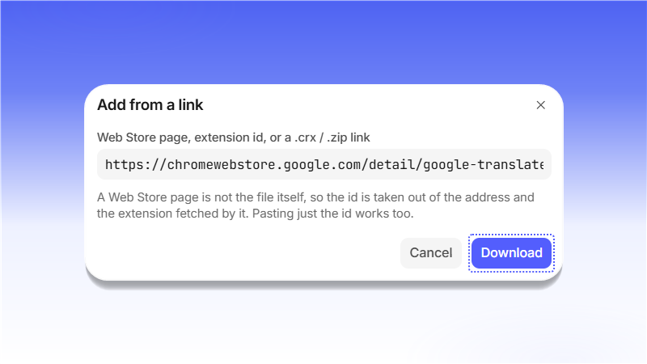

# Extensions

В разделе <mark style="color:purple;">**Extensions**</mark> хранятся расширения, которые можно подключать к профилям. Расширение добавляется один раз, а затем включается в нужных профилях.

Нажмите <mark style="color:purple;">**+ Add an extension**</mark>. Добавить расширение можно ссылкой на Chrome Web Store, файлом <mark style="color:purple;">`.crx`</mark> / <mark style="color:purple;">`.zip`</mark> или папкой.

<figure>
  <picture>
    <source srcset="../../.gitbook/assets/shardbrowser-extensions-empty_black.png" media="(prefers-color-scheme: dark)">
    
  </picture>
  <figcaption>Раздел Extensions</figcaption>
</figure>

В окне <mark style="color:purple;">**Add from a link**</mark> вставьте ссылку на страницу расширения в Web Store, его id или прямую ссылку на `.crx` / `.zip`. Из ссылки на Web Store ShardBrowser сам возьмёт id и скачает расширение. Нажмите <mark style="color:purple;">**Download**</mark>.

<figure>
  <picture>
    <source srcset="../../.gitbook/assets/shardbrowser-extension-add-link_black.png" media="(prefers-color-scheme: dark)">
    
  </picture>
  <figcaption>Вставьте ссылку и нажмите «Download»</figcaption>
</figure>

Расширение появится в списке с версией и размером.

<figure>
  <picture>
    <source srcset="../../.gitbook/assets/shardbrowser-extensions-list_black.png" media="(prefers-color-scheme: dark)">
    
  </picture>
  <figcaption>Расширение добавлено</figcaption>
</figure>

Чтобы включить расширение в профиле, откройте редактирование профиля (<mark style="color:purple;">**Edit**</mark>), перейдите на вкладку <mark style="color:purple;">**Extensions**</mark>, отметьте нужные расширения и нажмите <mark style="color:purple;">**Save**</mark>. Расширения также можно выбрать сразу при создании профиля, на вкладке <mark style="color:purple;">**Extensions**</mark> окна <mark style="color:purple;">**New profile**</mark>.

<figure>
  <picture>
    <source srcset="../../.gitbook/assets/shardbrowser-profile-edit-extensions_black.png" media="(prefers-color-scheme: dark)">
    
  </picture>
  <figcaption>Отметьте расширение в профиле и нажмите «Save»</figcaption>
</figure>
