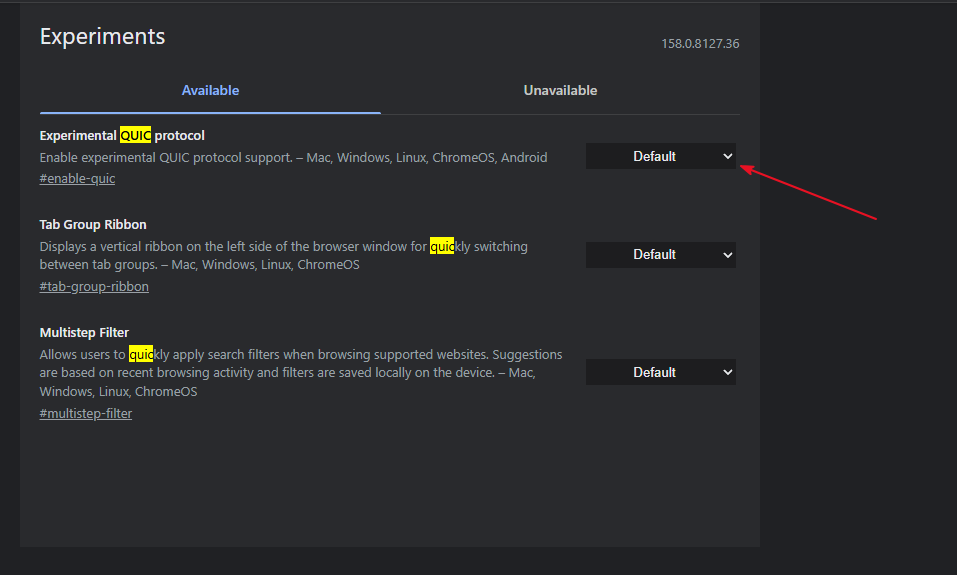
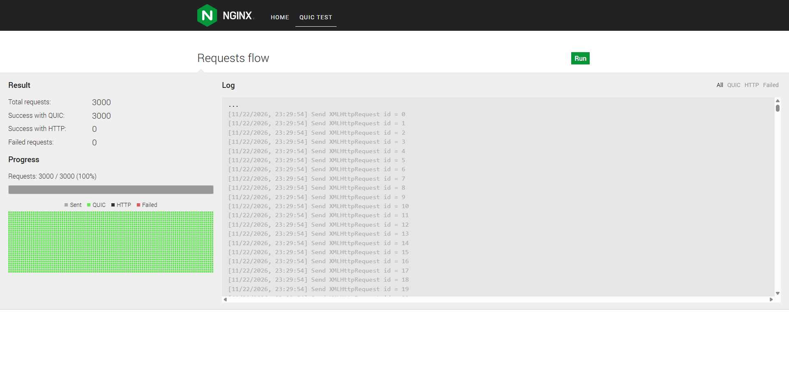
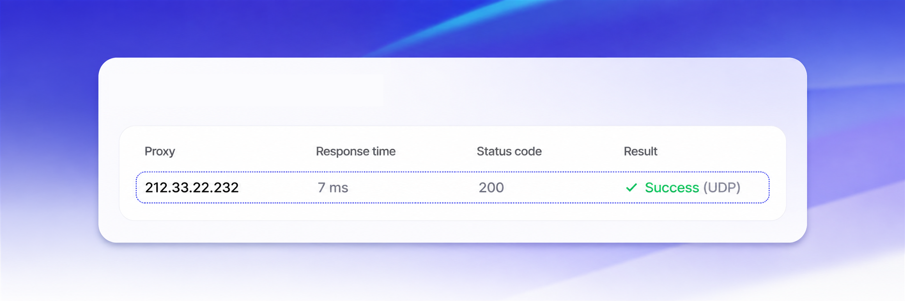
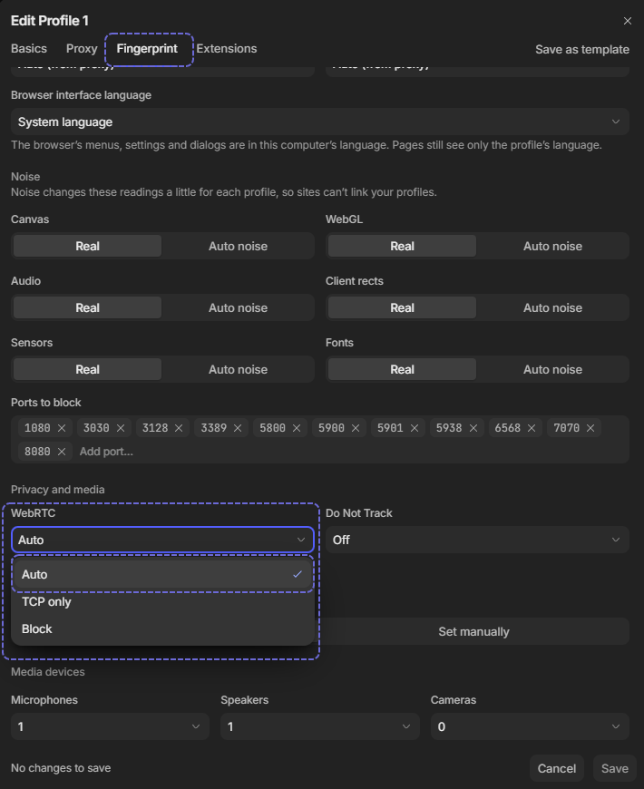

# Почему QUIC не работает, если UDP на прокси работает?

Если QUIC работает в обычном Google Chrome, но не работает в профиле ShardBrowser, проверьте флаги браузера и политики Windows. Политика может запрещать QUIC, даже когда в `chrome://flags` он включён.


Перед запуском профиля ShardBrowser проверяет поддержку `SOCKS5 UDP_ASSOCIATE`. Если UDP доступен, QUIC остаётся включённым автоматически; вручную менять флаг обычно не требуется. Эта инструкция нужна, если проверка UDP проходит, но тест QUIC всё равно не работает.


## 1. Проверьте QUIC в обычном Chrome

Откройте Google Chrome с обычным профилем и перейдите по адресу:

```text
chrome://flags/#enable-quic
```

Для параметра **Experimental QUIC protocol** должно быть выбрано **Default** или **Enabled**. Если выбрано **Disabled**, переключите параметр на **Enabled** и перезапустите браузер.

<figure><figcaption>Параметр Experimental QUIC protocol должен быть включён</figcaption></figure>

Затем откройте [тест QUIC от NGINX](https://quic.nginx.org/quic.html), нажмите **Run** и дождитесь результата. Запросы в строке **Success with QUIC** означают, что QUIC работает.

<figure><figcaption>Успешные запросы в строке Success with QUIC</figcaption></figure>

## 2. Повторите проверку в ShardBrowser

Внутри нужного профиля ShardBrowser откройте тот же адрес:

```text
chrome://flags/#enable-quic
```

Выберите **Default** или **Enabled**, при необходимости перезапустите профиль и повторите тест NGINX.

Для корректного сравнения используйте одинаковое подключение. Например, сначала запустите оба браузера без прокси в настройках браузера.


Если в Chrome тест проходит, а в ShardBrowser нет, одна из возможных причин - запрет QUIC в политиках Windows.


## 3. Проверьте политики через PowerShell

Откройте PowerShell и выполните:

```powershell
reg query "HKEY_LOCAL_MACHINE\SOFTWARE\Policies\Chromium" /v QuicAllowed
reg query "HKEY_CURRENT_USER\SOFTWARE\Policies\Chromium" /v QuicAllowed
reg query "HKEY_LOCAL_MACHINE\SOFTWARE\Policies\Google\Chrome" /v QuicAllowed
reg query "HKEY_CURRENT_USER\SOFTWARE\Policies\Google\Chrome" /v QuicAllowed
```

Как читать результат:

* **`QuicAllowed REG_DWORD 0x0`** - QUIC запрещён политикой.
* **`QuicAllowed REG_DWORD 0x1`** - QUIC разрешён политикой.
* **«Не удаётся найти указанный раздел или параметр»** - в этой ветке настройка отсутствует; это само по себе не означает запрет.

Обычный Chrome и ShardBrowser могут использовать разные ветки политик: `Google\Chrome` и `Chromium`. Поэтому запрет в ветке `Chromium` способен влиять на ShardBrowser, не затрагивая обычный Chrome.

## 4. Снимите обнаруженный запрет

Если именно в ветке `HKEY_LOCAL_MACHINE\SOFTWARE\Policies\Chromium` найдено `QuicAllowed = 0x0`, откройте **PowerShell от имени администратора** и выполните:

```powershell
Set-ItemProperty -Path 'HKLM:\SOFTWARE\Policies\Chromium' -Name 'QuicAllowed' -Value 1
```

Если запрет обнаружен в другой ветке, укажите в команде соответствующий путь.


На рабочем или управляемом организацией компьютере не меняйте политики самостоятельно: обратитесь к системному администратору. Централизованная политика может восстановить прежнее значение.


Полностью закройте профили ShardBrowser, запустите их заново и повторите тест NGINX. Перезагрузка Windows не требуется.


Если команда проверки уже показывает `QuicAllowed REG_DWORD 0x1`, QUIC в этой ветке разрешён и повторно менять параметр не нужно.


## 5. Если без прокси QUIC работает, а с прокси - нет

1. Убедитесь, что в профиле используется прокси **SOCKS5**. Для передачи QUIC через прокси требуется поддержка SOCKS5 UDP-relay.
2. Проверьте поддержку UDP и маршрут WebRTC:
   * в [IP Checker](https://shardx.com/ip-checker) обратите внимание на поле **WebRTC IP** - при корректной настройке в нём должен отображаться IP-адрес прокси, а не адрес вашего интернет-подключения;
   * в [Proxy Tester](https://shardx.com/proxy-tester) зелёная отметка **Success (UDP)** подтверждает поддержку UDP-relay.

<figure><figcaption>Proxy Tester подтверждает поддержку UDP</figcaption></figure>

3. Откройте настройки профиля ShardBrowser и на вкладке **Fingerprint** установите для параметра **WebRTC** режим **Auto**.

<figure><figcaption>Для параметра WebRTC выбран режим Auto</figcaption></figure>

После изменения настроек полностью закройте профиль и запустите его заново, чтобы ShardBrowser повторно проверил прокси.

## 6. Если QUIC всё ещё не работает

Откройте внутри проблемного профиля:

```text
chrome://policy
```

Нажмите **Reload policies** или **Обновить политики** и найдите `QuicAllowed`. Если запрещающей политики нет, проверьте параметры запуска профиля, поддержку UDP у прокси и сетевой журнал браузера.

Отсутствие QUIC только в одном браузере само по себе ещё не доказывает проблему с прокси или VPN.


QUIC также может не работать из-за встроенного брандмауэра Windows, правил фаервола роутера, работы VPN или ограничений со стороны интернет-провайдера. Некоторые VPN не передают QUIC или блокируют UDP-трафик. Такое также встречается в странах с жёстким регулированием и фильтрацией интернет-трафика: оператор или сетевой фильтр может блокировать UDP-трафик на порту `443` либо сам протокол QUIC. В этом случае проблема возникает на сетевом уровне и не связана с настройками ShardBrowser.

