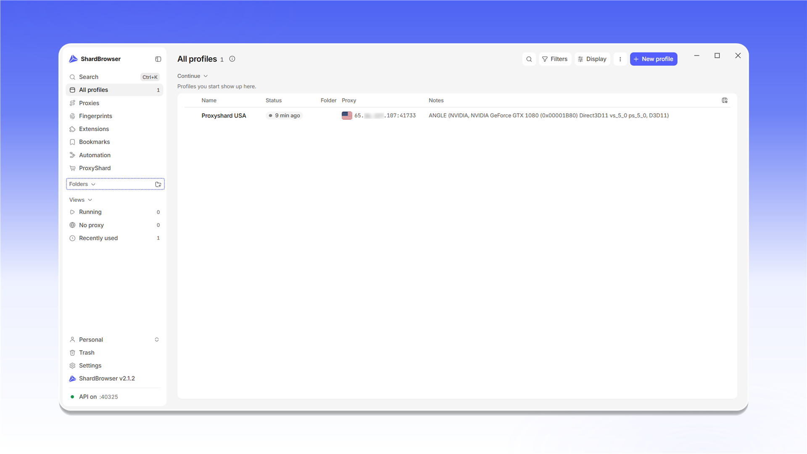
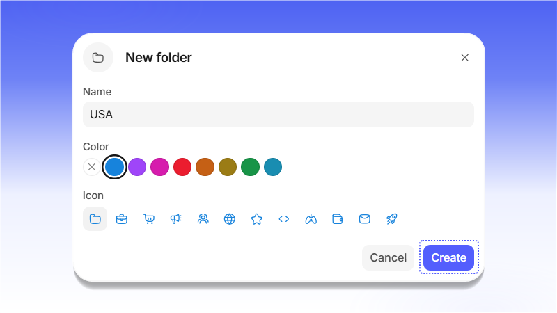

# Folders

Папки помогают разложить профили по проектам, странам или командам. Список папок находится в боковом меню, в блоке <mark style="color:purple;">**Folders**</mark>. Чтобы создать папку, нажмите значок <mark style="color:purple;">**+**</mark> рядом с <mark style="color:purple;">**Folders**</mark>.

<figure>
  <picture>
    <source srcset="../../.gitbook/assets/shardbrowser-folders-new_black.png" media="(prefers-color-scheme: dark)">
    
  </picture>
  <figcaption>Создание папки в боковом меню</figcaption>
</figure>

В окне <mark style="color:purple;">**New folder**</mark> укажите имя, выберите цвет и значок, затем нажмите <mark style="color:purple;">**Create**</mark>.

<figure>
  <picture>
    <source srcset="../../.gitbook/assets/shardbrowser-folder-create_black.png" media="(prefers-color-scheme: dark)">
    
  </picture>
  <figcaption>Укажите имя, цвет и значок папки</figcaption>
</figure>

Папка появится в боковом меню. Новые профили, созданные внутри папки (<mark style="color:purple;">**+ New profile**</mark>), сразу попадают в неё. Текущий фильтр папки можно сохранить в <mark style="color:purple;">**Views**</mark> кнопкой <mark style="color:purple;">**Save as view**</mark>.

<figure>
  <picture>
    <source srcset="../../.gitbook/assets/shardbrowser-folder-empty_black.png" media="(prefers-color-scheme: dark)">
    
  </picture>
  <figcaption>Пустая папка</figcaption>
</figure>

Чтобы перенести существующий профиль, откройте меню профиля (<mark style="color:purple;">**⋮**</mark>) и выберите <mark style="color:purple;">**Move to folder**</mark> (клавиша `M`). Профиль также можно перетащить на папку в боковом меню.

<figure>
  <picture>
    <source srcset="../../.gitbook/assets/shardbrowser-profile-move-to-folder_black.png" media="(prefers-color-scheme: dark)">
    
  </picture>
  <figcaption>Меню профиля - «Move to folder»</figcaption>
</figure>
