# Team server


Тим-сервер позволяет нескольким людям работать с общими профилями ShardBrowser. Сервер вы запускаете сами, например на VPS: профили команды хранятся на нём, а лаунчеры участников подключаются к серверу по инвайту. Администратор сам решает, какие папки и действия доступны каждому участнику.


## Что понадобится

* ShardBrowser версии 2.1.2 или новее на компьютерах всех участников.
* Сервер, к которому участники могут подключиться по сети, например VPS на Ubuntu с доступом по SSH под `root` или пользователем с `sudo`.
* Открытый входящий порт <mark style="color:purple;">`8787`</mark> (TCP) на сервере.

---

## Создание команды в ShardBrowser

В левом нижнем углу нажмите на переключатель рабочего пространства <mark style="color:purple;">**Personal**</mark> и выберите <mark style="color:purple;">**Create a team...**</mark>.

<figure>
  <picture>
    <source srcset="../../.gitbook/assets/shardbrowser-team-workspace-menu_black.png" media="(prefers-color-scheme: dark)">
    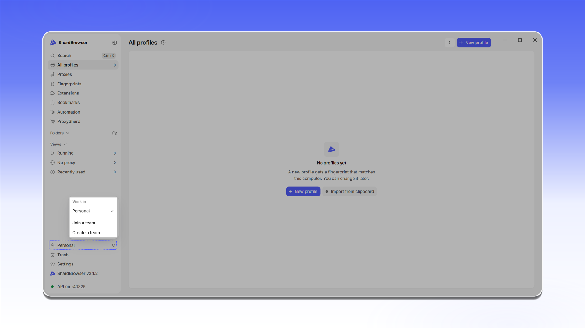
  </picture>
  <figcaption>Меню рабочего пространства - «Create a team...»</figcaption>
</figure>

Откроется окно <mark style="color:purple;">**Create a team**</mark>. В поле <mark style="color:purple;">**Team name**</mark> укажите название команды. Сервер читает его только при первом запуске, позже команду можно переименовать на её странице.

<figure>
  <picture>
    <source srcset="../../.gitbook/assets/shardbrowser-team-create-dialog_black.png" media="(prefers-color-scheme: dark)">
    
  </picture>
  <figcaption>Окно Create a team - укажите название команды</figcaption>
</figure>

Не закрывайте это окно: команда для запуска сервера и поля для подключения понадобятся дальше.

---

## Установка Docker и тим-сервера на VPS

Подключитесь к серверу по SSH и установите Docker официальным скриптом:

```bash
curl -fsSL https://get.docker.com -o get-docker.sh
sudo sh get-docker.sh
```

Скрипт сам добавит репозиторий Docker, установит пакеты и запустит службу. В конце он выведет версии клиента и сервера Docker Engine.

<figure>
  <picture>
    <source srcset="../../.gitbook/assets/shardbrowser-team-vps-docker-install_black.png" media="(prefers-color-scheme: dark)">
    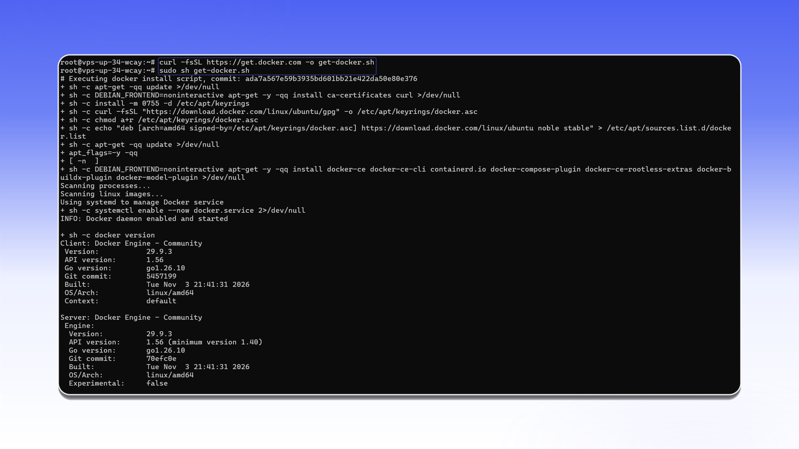
  </picture>
  <figcaption>Установка Docker скриптом get-docker.sh</figcaption>
</figure>

Если в конце появилось сообщение о rootless-режиме и доступе к Docker API, это обычная справка от установщика. Для тим-сервера ничего дополнительно настраивать не нужно.

<figure>
  <picture>
    <source srcset="../../.gitbook/assets/shardbrowser-team-vps-docker-install-done_black.png" media="(prefers-color-scheme: dark)">
    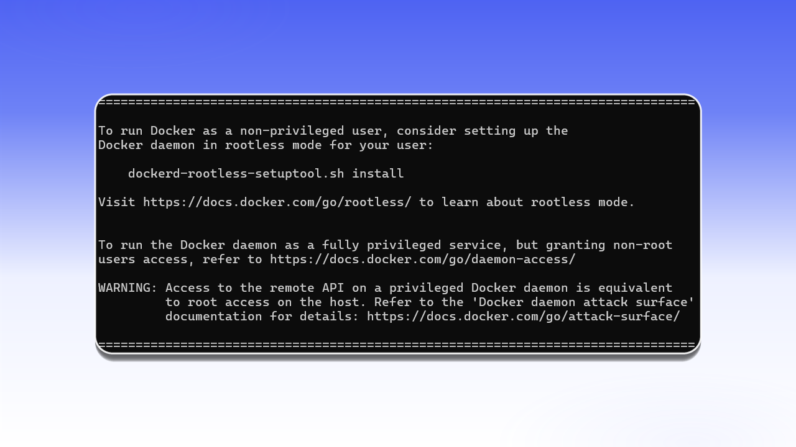
  </picture>
  <figcaption>Справка установщика Docker в конце установки</figcaption>
</figure>

Вернитесь в ShardBrowser. На вкладке <mark style="color:purple;">**Docker**</mark> окна <mark style="color:purple;">**Create a team**</mark> уже готова команда запуска сервера с названием вашей команды. Скопируйте её кнопкой справа от поля.

<figure>
  <picture>
    <source srcset="../../.gitbook/assets/shardbrowser-team-create-docker-command_black.png" media="(prefers-color-scheme: dark)">
    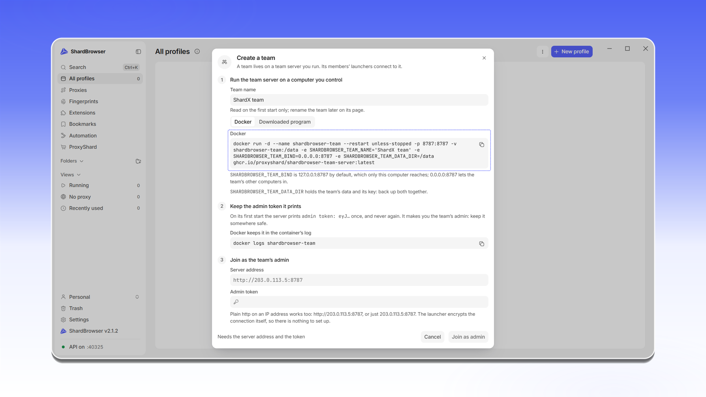
  </picture>
  <figcaption>Скопируйте команду запуска на вкладке Docker</figcaption>
</figure>


`SHARDBROWSER_TEAM_BIND` по умолчанию равен `127.0.0.1:8787`, и тогда к серверу можно подключиться только с этой же машины. Чтобы подключались остальные участники, оставьте в команде `0.0.0.0:8787`.

`SHARDBROWSER_TEAM_DATA_DIR` - папка с данными команды и её ключом. Делайте резервную копию всей папки целиком.


На сервере включите автозапуск Docker, проверьте установку и выполните скопированную команду:

```bash
sudo systemctl enable docker
sudo systemctl start docker
sudo usermod -aG docker $USER
docker --version
docker compose version
```

```bash
docker run -d --name shardbrowser-team --restart unless-stopped -p 8787:8787 -v shardbrowser-team:/data -e SHARDBROWSER_TEAM_NAME='ShardX team' -e SHARDBROWSER_TEAM_BIND=0.0.0.0:8787 -e SHARDBROWSER_TEAM_DATA_DIR=/data ghcr.io/proxyshard/shardbrowser-team-server:latest
```

Вместо `ShardX team` в команде будет название, которое вы указали. Docker скачает образ `shardbrowser-team-server` и запустит контейнер `shardbrowser-team`. Благодаря `--restart unless-stopped` сервер сам поднимется после перезагрузки VPS.

<figure>
  <picture>
    <source srcset="../../.gitbook/assets/shardbrowser-team-vps-server-run_black.png" media="(prefers-color-scheme: dark)">
    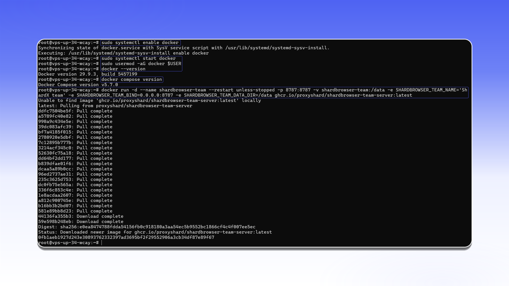
  </picture>
  <figcaption>Запуск контейнера тим-сервера</figcaption>
</figure>

При первом запуске сервер один раз выводит в лог токен администратора. Посмотрите его командой:

```bash
docker logs shardbrowser-team
```

Скопируйте значение <mark style="color:purple;">`admin token`</mark>. В логе также есть <mark style="color:purple;">`invite`</mark> (ссылка с тем же токеном, вместо `0.0.0.0` подставьте адрес сервера) и <mark style="color:purple;">`public key`</mark>, по которому лаунчеры проверяют сервер.

<figure>
  <picture>
    <source srcset="../../.gitbook/assets/shardbrowser-team-vps-admin-token_black.png" media="(prefers-color-scheme: dark)">
    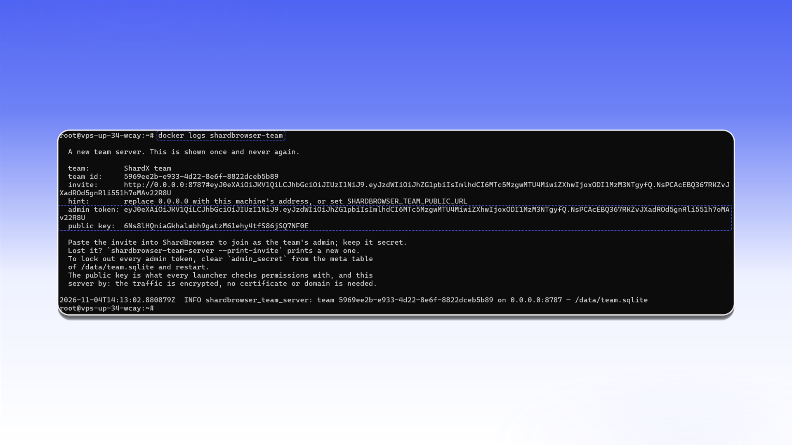
  </picture>
  <figcaption>Токен администратора в логе контейнера</figcaption>
</figure>


Токен администратора показывается только при первом запуске и даёт полный доступ к команде. Сохраните его в надёжном месте и никому не передавайте. Если токен потерян, команда `shardbrowser-team-server --print-invite` выведет новый.


---

## Подключение к команде как администратор

В окне <mark style="color:purple;">**Create a team**</mark>, в блоке <mark style="color:purple;">**Join as the team's admin**</mark>, заполните поля:

* <mark style="color:purple;">**Server address**</mark> - IP-адрес сервера и порт, например `203.0.113.5:8787` или `http://203.0.113.5:8787`. Домен и сертификат не нужны: лаунчер сам шифрует соединение.
* <mark style="color:purple;">**Admin token**</mark> - токен из лога контейнера.

Нажмите <mark style="color:purple;">**Join as admin**</mark>.

<figure>
  <picture>
    <source srcset="../../.gitbook/assets/shardbrowser-team-join-as-admin_black.png" media="(prefers-color-scheme: dark)">
    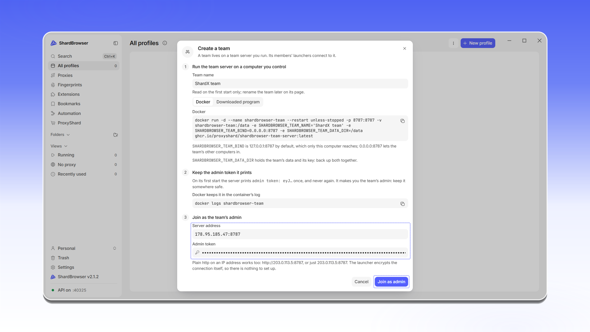
  </picture>
  <figcaption>Укажите адрес сервера и токен администратора</figcaption>
</figure>

Откроется страница команды. В переключателе слева внизу теперь выбрана ваша команда. Профили, созданные в этом режиме, хранятся на тим-сервере. Блок <mark style="color:purple;">**Getting the team going**</mark> подсказывает порядок действий: создать папки, создать профили, добавить участников и выдать им права.

<figure>
  <picture>
    <source srcset="../../.gitbook/assets/shardbrowser-team-page-empty_black.png" media="(prefers-color-scheme: dark)">
    
  </picture>
  <figcaption>Страница новой команды</figcaption>
</figure>

---

## Добавление участника

Нажмите <mark style="color:purple;">**+ Add member**</mark>.

<figure>
  <picture>
    <source srcset="../../.gitbook/assets/shardbrowser-team-add-member-button_black.png" media="(prefers-color-scheme: dark)">
    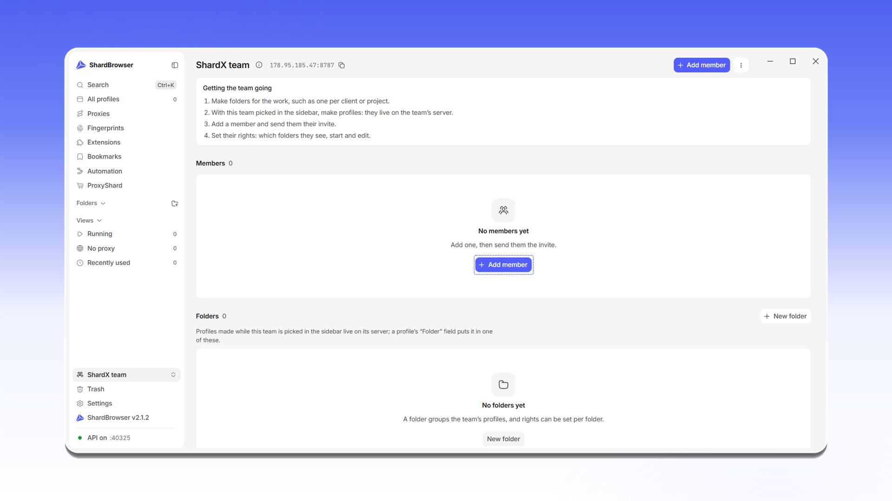
  </picture>
  <figcaption>Кнопка Add member</figcaption>
</figure>

Укажите имя участника и нажмите <mark style="color:purple;">**Add member**</mark>.

<figure>
  <picture>
    <source srcset="../../.gitbook/assets/shardbrowser-team-add-member-dialog_black.png" media="(prefers-color-scheme: dark)">
    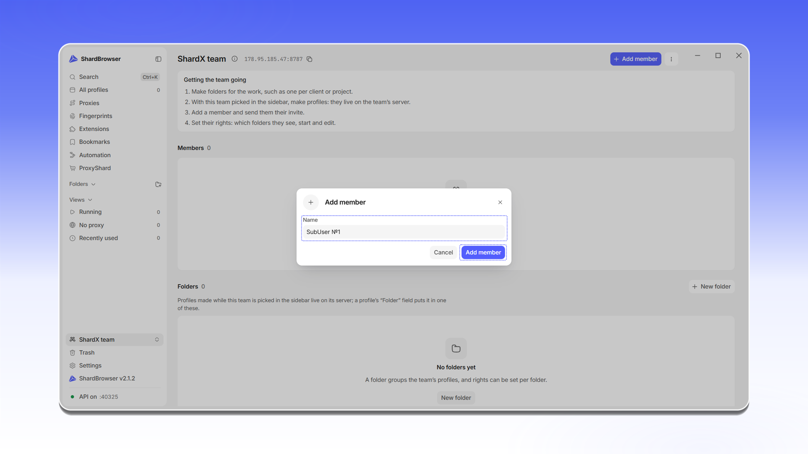
  </picture>
  <figcaption>Имя нового участника</figcaption>
</figure>

Появится инвайт для участника. Скопируйте его и отправьте участнику: он вставит его в окне <mark style="color:purple;">**Join a team**</mark>. Инвайт показывается только один раз, новый можно создать через <mark style="color:purple;">**New invite...**</mark> в меню участника.

Пока у участника нет прав, команда для него пустая. Нажмите <mark style="color:purple;">**Set rights...**</mark>, чтобы сразу выдать доступ.

<figure>
  <picture>
    <source srcset="../../.gitbook/assets/shardbrowser-team-member-invite_black.png" media="(prefers-color-scheme: dark)">
    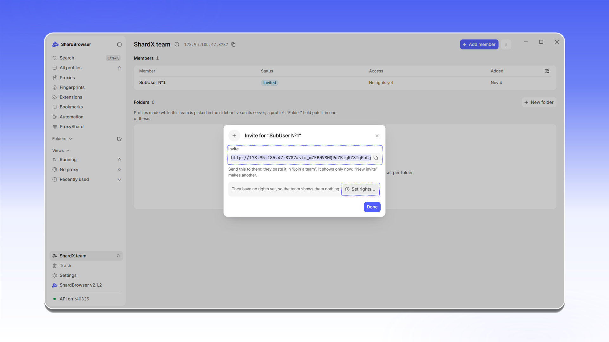
  </picture>
  <figcaption>Инвайт для участника и кнопка Set rights</figcaption>
</figure>

---

## Права участника

В окне <mark style="color:purple;">**Rights**</mark> права задаются в таблице. Нажмите на ячейку (или клавишу `Space`), чтобы переключить её: не задано, разрешено (галочка) или запрещено (крестик). Если правила пересекаются, действует самое узкое.

| Право        | Что разрешает                    |
| ------------ | -------------------------------- |
| **See**      | Видеть профили                   |
| **Start**    | Запускать профили                |
| **Edit**     | Изменять профили                 |
| **Create**   | Создавать профили                |
| **Delete**   | Удалять профили                  |
| **Cookies**  | Работать с cookies профилей      |
| **Take out** | Выносить профили из команды      |

Для быстрой настройки строки <mark style="color:purple;">**Whole team**</mark> есть готовые наборы: <mark style="color:purple;">**None**</mark>, <mark style="color:purple;">**See only**</mark>, <mark style="color:purple;">**Start**</mark>, <mark style="color:purple;">**Edit**</mark> и <mark style="color:purple;">**All but take out**</mark>. Права также можно задать отдельно для каждой папки команды. Нажмите <mark style="color:purple;">**Save rights**</mark>.

<figure>
  <picture>
    <source srcset="../../.gitbook/assets/shardbrowser-team-member-rights_black.png" media="(prefers-color-scheme: dark)">
    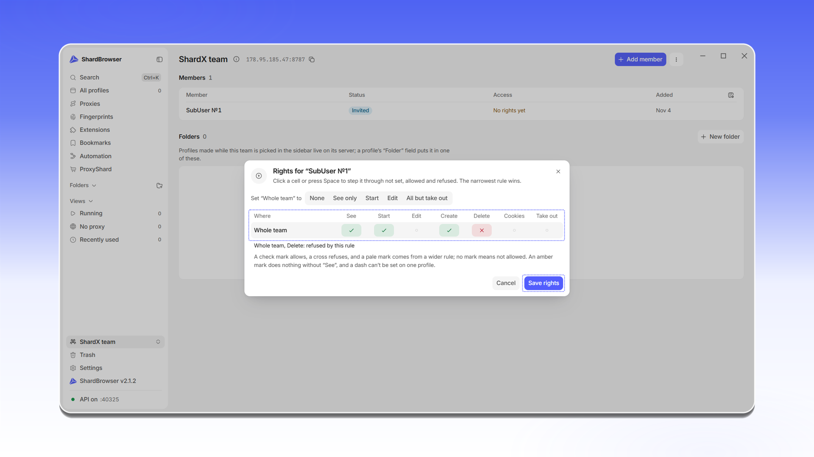
  </picture>
  <figcaption>Права участника на всю команду</figcaption>
</figure>


Право без <mark style="color:purple;">**See**</mark> не работает: участник не сможет запустить или изменить профиль, которого не видит.


Выданные права отображаются в колонке <mark style="color:purple;">**Access**</mark>. В меню участника (<mark style="color:purple;">**⋮**</mark>) можно изменить права (<mark style="color:purple;">**Rights...**</mark>), временно отключить участника (<mark style="color:purple;">**Switch off**</mark>), создать новый инвайт (<mark style="color:purple;">**New invite...**</mark>) или удалить участника из команды (<mark style="color:purple;">**Remove...**</mark>).

<figure>
  <picture>
    <source srcset="../../.gitbook/assets/shardbrowser-team-member-menu_black.png" media="(prefers-color-scheme: dark)">
    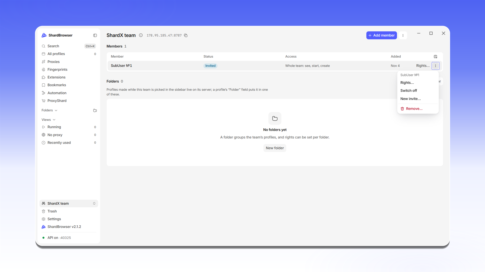
  </picture>
  <figcaption>Меню участника</figcaption>
</figure>

---

## Папки и профили команды

Папки команды создаются кнопкой <mark style="color:purple;">**+ New folder**</mark> на странице команды и появляются в боковом меню, как обычные папки. Новый профиль попадает в папку, указанную в его поле <mark style="color:purple;">**Folder**</mark>.

Переключатель рабочего пространства внизу слева показывает, где вы сейчас работаете: в <mark style="color:purple;">**Personal**</mark> (локальные профили) или в команде, рядом с которой указан адрес её сервера. Из этого меню администратор открывает страницу команды (<mark style="color:purple;">**Manage team**</mark>), а также может подключиться к другой команде, создать новую или выйти из текущей (<mark style="color:purple;">**Leave this team...**</mark>).

<figure>
  <picture>
    <source srcset="../../.gitbook/assets/shardbrowser-team-manage-team-menu_black.png" media="(prefers-color-scheme: dark)">
    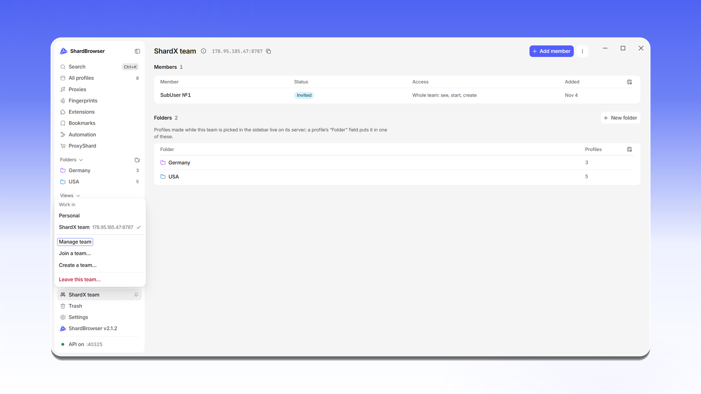
  </picture>
  <figcaption>Папки команды и меню Manage team</figcaption>
</figure>

---

## Подключение участника к команде

Участник открывает ShardBrowser, нажимает на переключатель <mark style="color:purple;">**Personal**</mark> и выбирает <mark style="color:purple;">**Join a team...**</mark>.

<figure>
  <picture>
    <source srcset="../../.gitbook/assets/shardbrowser-team-join-menu_black.png" media="(prefers-color-scheme: dark)">
    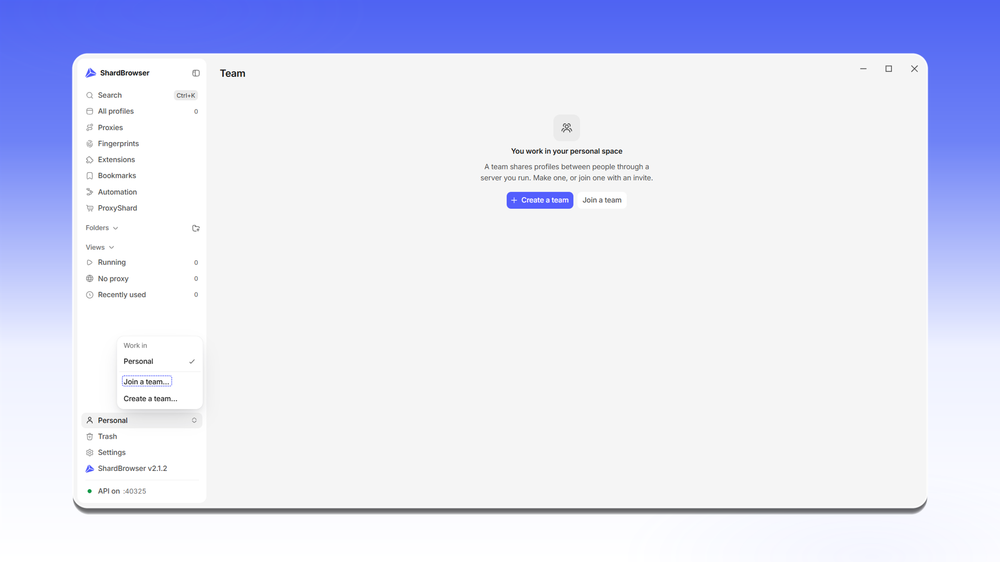
  </picture>
  <figcaption>Меню рабочего пространства - «Join a team...»</figcaption>
</figure>

В окне <mark style="color:purple;">**Join a team**</mark> нужно вставить инвайт, полученный от администратора, в поле <mark style="color:purple;">**Invite or server address**</mark>. Адрес сервера и <mark style="color:purple;">**Access token**</mark> заполнятся сами. Затем нажмите <mark style="color:purple;">**Join**</mark>.

<figure>
  <picture>
    <source srcset="../../.gitbook/assets/shardbrowser-team-join-dialog_black.png" media="(prefers-color-scheme: dark)">
    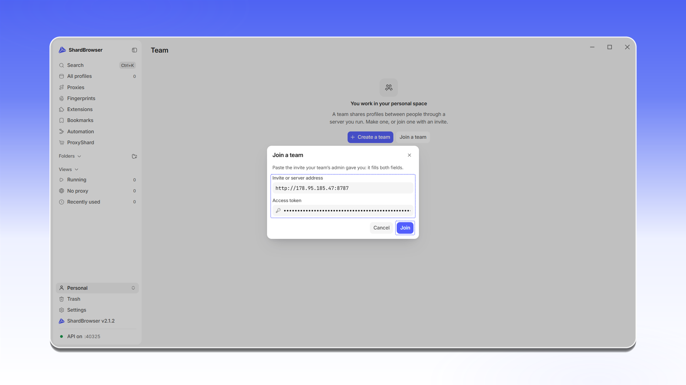
  </picture>
  <figcaption>Вставьте инвайт в окне Join a team</figcaption>
</figure>

После подключения в меню переключателя у участника появляется пункт <mark style="color:purple;">**Your access**</mark>. Он показывает, какие права выдал администратор. Изменить их может только администратор.

<figure>
  <picture>
    <source srcset="../../.gitbook/assets/shardbrowser-team-your-access_black.png" media="(prefers-color-scheme: dark)">
    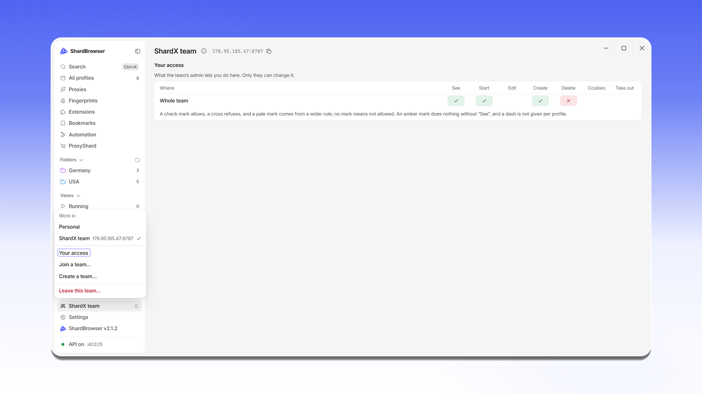
  </picture>
  <figcaption>Права участника в разделе Your access</figcaption>
</figure>

В разделе <mark style="color:purple;">**All profiles**</mark> участник видит профили команды из доступных ему папок и работает с ними в пределах выданных прав. Чтобы вернуться к локальным профилям, выберите <mark style="color:purple;">**Personal**</mark> в переключателе.

<figure>
  <picture>
    <source srcset="../../.gitbook/assets/shardbrowser-team-profiles_black.png" media="(prefers-color-scheme: dark)">
    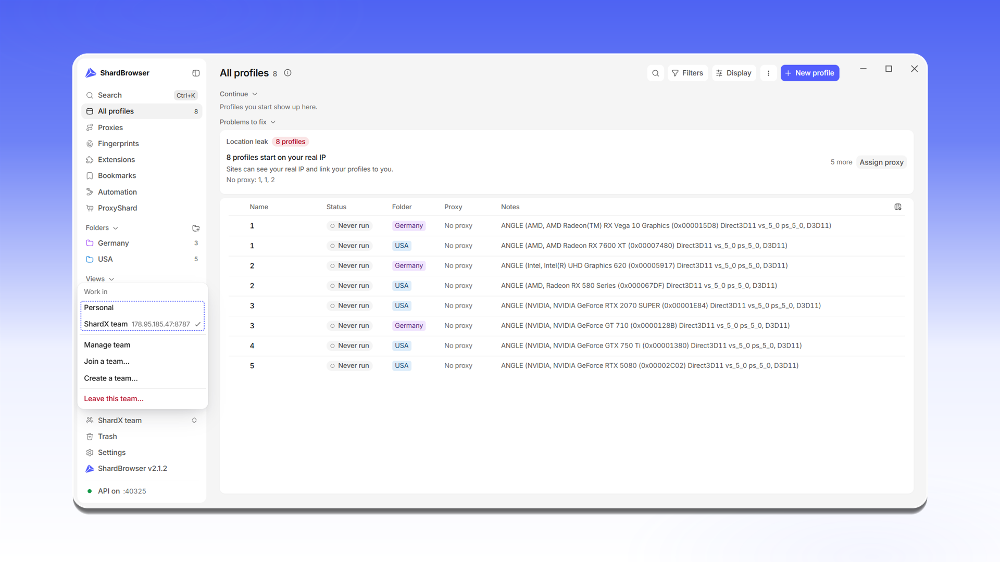
  </picture>
  <figcaption>Профили команды у участника</figcaption>
</figure>
