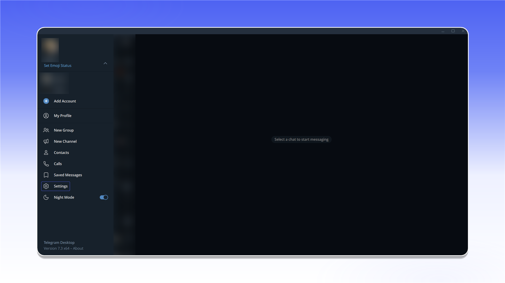
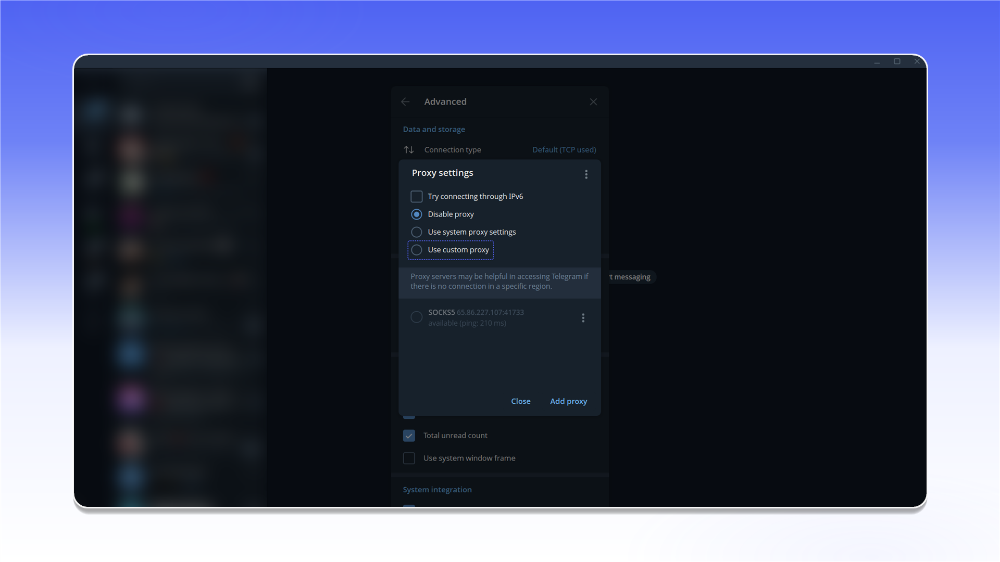
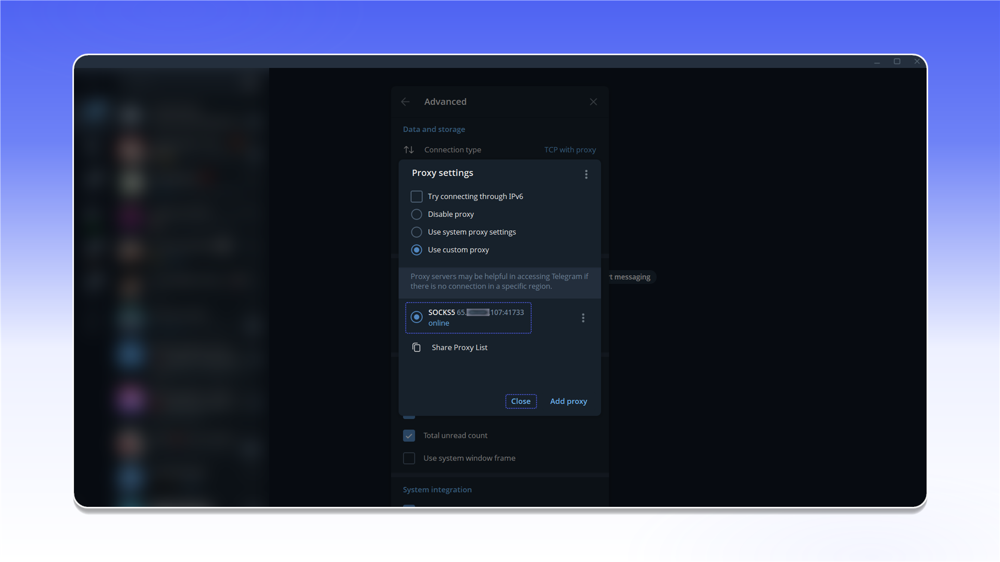
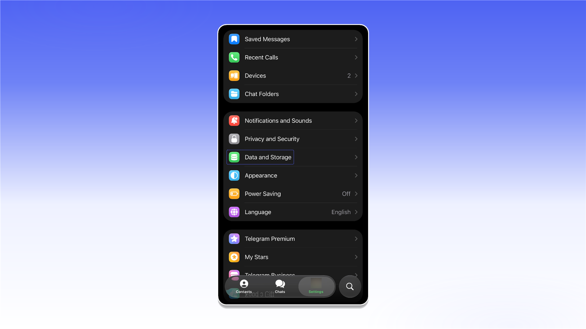
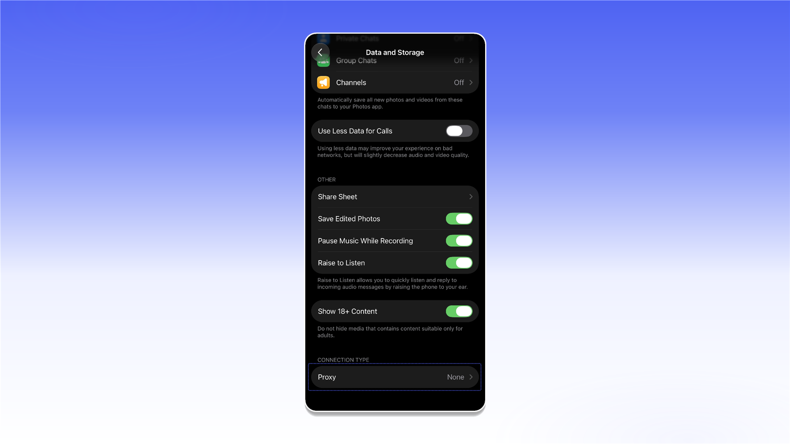
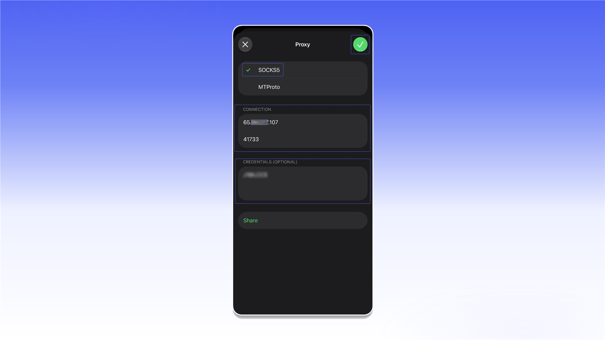

# Telegram

### Настройка прокси для Desktop версии Telegram

Для настройки прокси в <mark style="color:purple;">Telegram</mark> перейдите в Settings.

<figure>
  <picture>
    <source srcset="../.gitbook/assets/telegram-desktop-menu-settings_black.png" media="(prefers-color-scheme: dark)">
    
  </picture>
</figure>

Затем откройте "Расширенные" настройки

<figure>
  <picture>
    <source srcset="../.gitbook/assets/telegram-desktop-settings-advanced_black.png" media="(prefers-color-scheme: dark)">
    
  </picture>
</figure>

Выберите тип подключения "TCP"

<figure>
  <picture>
    <source srcset="../.gitbook/assets/telegram-desktop-connection-type_black.png" media="(prefers-color-scheme: dark)">
    
  </picture>
</figure>

Далее укажите подключение к прокси

Выберите удобный для вас протокол подключения, по умолчанию это HTTP


**С примером настройки прокси вы можете ознакомиться в разделе [Инструкция по настройке](getting-started.md)**


<figure>
  <picture>
    <source srcset="../.gitbook/assets/telegram-desktop-use-custom-proxy_black.png" media="(prefers-color-scheme: dark)">
    
  </picture>
</figure>

Затем проверьте подключение и сохраните

<figure>
  <picture>
    <source srcset="../.gitbook/assets/telegram-desktop-proxy-connected_black.png" media="(prefers-color-scheme: dark)">
    
  </picture>
</figure>

**Готово! Теперь вы можете пользоваться Telegram с нашими прокси.**

### Настройка прокси для Mobile версии Telegram

Для настройки прокси на телефоне, требуется открыть настройки и выбрать пункт "Data and Storage"

<figure>
  <picture>
    <source srcset="../.gitbook/assets/telegram-ios-settings-data-storage_black.png" media="(prefers-color-scheme: dark)">
    
  </picture>
</figure>

После выбрать пункт "Proxy"

<figure>
  <picture>
    <source srcset="../.gitbook/assets/telegram-ios-connection-proxy_black.png" media="(prefers-color-scheme: dark)">
    
  </picture>
</figure>

Укажите протокол SOCKS5 и впишите данные для подключения к прокси

<figure>
  <picture>
    <source srcset="../.gitbook/assets/telegram-ios-proxy-socks5-form_black.png" media="(prefers-color-scheme: dark)">
    
  </picture>
</figure>

Обязательно сохраните настройку и дальше вы можете использовать прокси внутри _Telegram._
