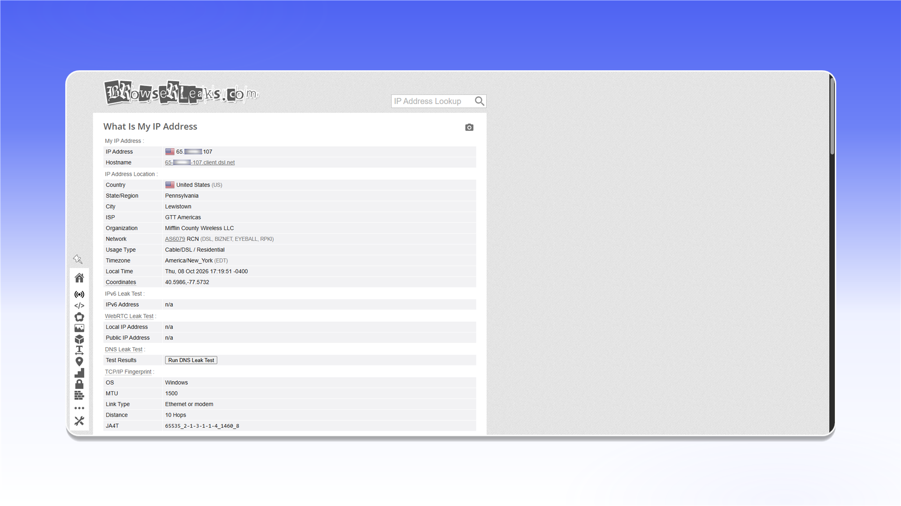

# Clash for Windows


Clash for Windows поддерживает проксирование TCP- и UDP-трафика в режиме TUN.


## Скачивание и запуск

Откройте [страницу релизов Clash for Windows](https://github.com/lantongxue/clash_for_windows_pkg/releases) и скачайте архив `Clash.for.Windows-0.20.39-win.7z`.

<figure>
  <picture>
    <source srcset="../../.gitbook/assets/clashx-github-download_black.png" media="(prefers-color-scheme: dark)">
    
  </picture>
</figure>

Распакуйте архив в отдельную папку.

<figure><figcaption></figcaption></figure>

Запустите `Clash for Windows.exe` от имени администратора. Это требуется для установки и работы системного сетевого драйвера.

<figure><figcaption></figcaption></figure>

## Настройка профиля

1. Откройте раздел `Profiles`.
2. Нажмите значок `<>` рядом с файлом `config.yaml`.

<figure>
  <picture>
    <source srcset="../../.gitbook/assets/clashx-profiles-edit-config_black.png" media="(prefers-color-scheme: dark)">
    
  </picture>
</figure>

Добавьте прокси в блок `proxies:` и укажите данные из заказа. В примере используется SOCKS5.

```yaml
proxies:
  - name: "ShardX-Germany"
    type: socks5
    server: 123.123.123.123
    port: 41733
    username: proxy_login
    password: proxy_password
    udp: true

proxy-groups:
  - name: "ShardX"
    type: select
    proxies:
      - ShardX-Germany

rules:
  - PROCESS-NAME,chrome.exe,ShardX
  - MATCH,DIRECT
```

`name` задаёт название подключения. В полях `server`, `port`, `username` и `password` укажите данные прокси. Параметр `udp: true` включает UDP для этого сервера.

<figure>
  <picture>
    <source srcset="../../.gitbook/assets/clashx-profile-config-proxies_black.png" media="(prefers-color-scheme: dark)">
    
  </picture>
</figure>


Расположение данных подключения описано в [общей инструкции](../getting-started.md).


## Активация и проверка прокси

1. Перейдите в раздел `Proxies`.
2. Выберите режим `Global`.
3. Нажмите `Check` рядом с добавленным сервером.

<figure>
  <picture>
    <source srcset="../../.gitbook/assets/clashx-proxies-global-select_black.png" media="(prefers-color-scheme: dark)">
    
  </picture>
</figure>

Если подключение доступно, на карточке появится время отклика.

<figure><figcaption></figcaption></figure>

## Несколько прокси

Добавьте каждый сервер отдельным элементом в `proxies:` и перечислите их названия в группе `ShardX`. После сохранения конфигурации серверы появятся в разделе `Proxies`, где между ними можно переключаться.

<figure>
  <picture>
    <source srcset="../../.gitbook/assets/clashx-proxies-multiple-list_black.png" media="(prefers-color-scheme: dark)">
    
  </picture>
</figure>

## Включение TUN Mode

1. Откройте раздел `General`.
2. В строке `TAP Device` нажмите `Manage`, затем `Install`.
3. Включите `TUN Mode`, чтобы направить системный трафик через выбранный прокси.

<figure>
  <picture>
    <source srcset="../../.gitbook/assets/clashx-general-tap-tun-setup_black.png" media="(prefers-color-scheme: dark)">
    
  </picture>
</figure>

## Проверка подключения

Откройте [ShardX IP Checker](https://proxyshard.com/tools/ip-checker) и убедитесь, что отображается адрес прокси.

<figure>
  <picture>
    <source srcset="../../.gitbook/assets/clashx-ip-checker-result_black.png" media="(prefers-color-scheme: dark)">
    
  </picture>
</figure>

Дополнительно проверьте WebRTC через сервис BrowserLeaks.

<figure>
  <picture>
    <source srcset="../../.gitbook/assets/clashx-browserleaks-check_black.png" media="(prefers-color-scheme: dark)">
    
  </picture>
</figure>

Если соединение не работает, проверьте данные в `config.yaml`, повторно запустите программу от имени администратора и воспользуйтесь [инструкцией по диагностике](../../faq-and-support/faq/proxy-not-working.md).
