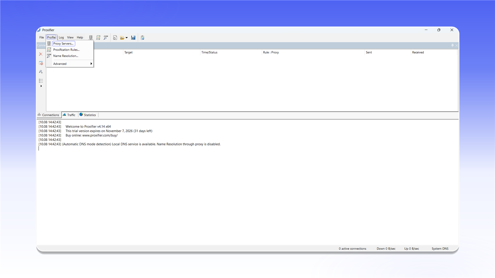
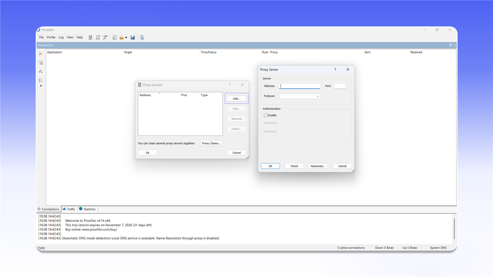
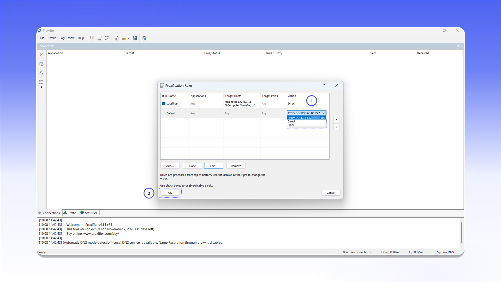

# Proxifier


Proxifier не поддерживает проксирование UDP-трафика.



Proxifier является платной программой. Пробный период составляет 31 день.


## Установка

Откройте [страницу загрузки Proxifier](https://www.proxifier.com/download/), скачайте `ProxifierSetup.exe` и установите программу.

<figure>
  <picture>
    <source srcset="../../.gitbook/assets/proxifier-website-download_black.png" media="(prefers-color-scheme: dark)">
    
  </picture>
</figure>

## Добавление прокси

1. Запустите Proxifier.
2. Откройте меню `Profile` и выберите `Proxy Servers...`.

<figure>
  <picture>
    <source srcset="../../.gitbook/assets/proxifier-menu-proxy-servers_black.png" media="(prefers-color-scheme: dark)">
    
  </picture>
</figure>

В окне `Proxy Servers` нажмите `Add...` и заполните форму:

- `Address`: IP-адрес или домен прокси;
- `Port`: порт подключения;
- `Protocol`: `SOCKS Version 5` или `HTTPS` для HTTP-прокси;
- `Authentication`: включите `Enable`, затем укажите `Username` и `Password`.

<figure>
  <picture>
    <source srcset="../../.gitbook/assets/proxifier-add-proxy-dialog_black.png" media="(prefers-color-scheme: dark)">
    
  </picture>
</figure>


Расположение данных подключения описано в [общей инструкции](../getting-started.md).


Нажмите `Check`. После сообщения `Proxy is ready to work with Proxifier!` закройте окно проверки кнопкой `OK` и сохраните сервер.

<figure>
  <picture>
    <source srcset="../../.gitbook/assets/proxifier-proxy-check-success_black.png" media="(prefers-color-scheme: dark)">
    
  </picture>
</figure>

## Настройка маршрутизации

Откройте меню `Profile` и выберите `Proxification Rules...`.

<figure>
  <picture>
    <source srcset="../../.gitbook/assets/proxifier-menu-proxification-rules_black.png" media="(prefers-color-scheme: dark)">
    
  </picture>
</figure>

В строке `Default` откройте список в столбце `Action`, выберите добавленный SOCKS5-прокси и нажмите `OK`. После этого трафик приложений будет направляться через выбранный сервер.

<figure>
  <picture>
    <source srcset="../../.gitbook/assets/proxifier-rules-configuration_black.png" media="(prefers-color-scheme: dark)">
    
  </picture>
</figure>
