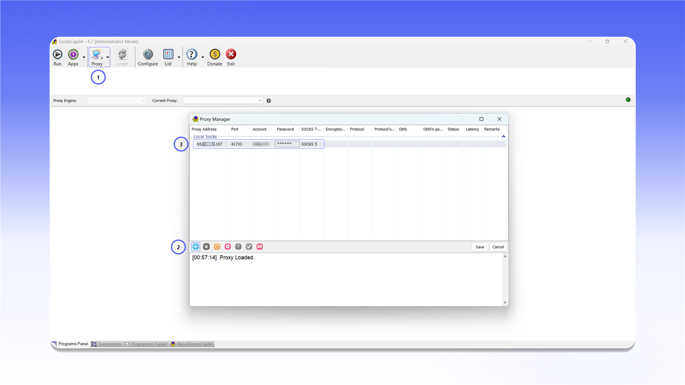
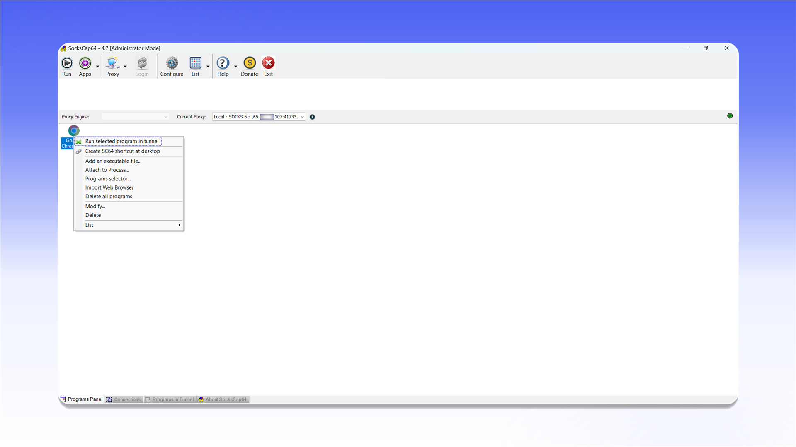

# SocksCap64


SocksCap64 поддерживает проксирование TCP- и UDP-трафика.


## Установка

Скачайте `SocksCap64-setup-4.7.exe` со [страницы релиза](https://github.com/bobo2334/sockscap64/releases/tag/4.7), установите программу и запустите её от имени администратора.

<figure>
  <picture>
    <source srcset="../../.gitbook/assets/sockscap64-github-download_black.png" media="(prefers-color-scheme: dark)">
    
  </picture>
</figure>

## Добавление прокси

1. Нажмите `Proxy` в верхней панели.
2. В окне `Proxy Manager` нажмите кнопку `+`.
3. Заполните строку подключения:
   - `Proxy Address`: IP-адрес или домен сервера;
   - `Port`: порт подключения;
   - `Account`: логин;
   - `Password`: пароль;
   - `SOCKS Type`: `SOCKS 5`.
4. Нажмите `Save`.

<figure>
  <picture>
    <source srcset="../../.gitbook/assets/sockscap64-proxy-manager-config_black.png" media="(prefers-color-scheme: dark)">
    
  </picture>
</figure>


Расположение данных подключения описано в [общей инструкции](../getting-started.md).


## Добавление программы

Нажмите `Apps`, выберите нужное приложение в окне `Programs selector` и нажмите `OK`.

<figure>
  <picture>
    <source srcset="../../.gitbook/assets/sockscap64-programs-selector-add_black.png" media="(prefers-color-scheme: dark)">
    
  </picture>
</figure>

## Запуск через прокси

Щёлкните правой кнопкой мыши по добавленному приложению и выберите `Run selected program in tunnel`. Программа запустится через настроенный SOCKS5-прокси.

<figure>
  <picture>
    <source srcset="../../.gitbook/assets/sockscap64-run-program-in-tunnel_black.png" media="(prefers-color-scheme: dark)">
    
  </picture>
</figure>
