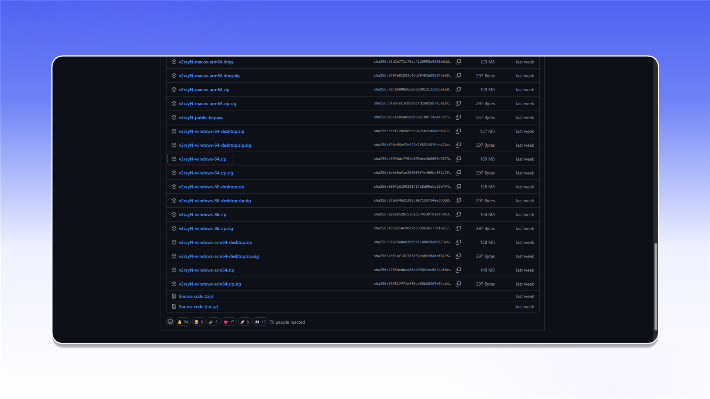
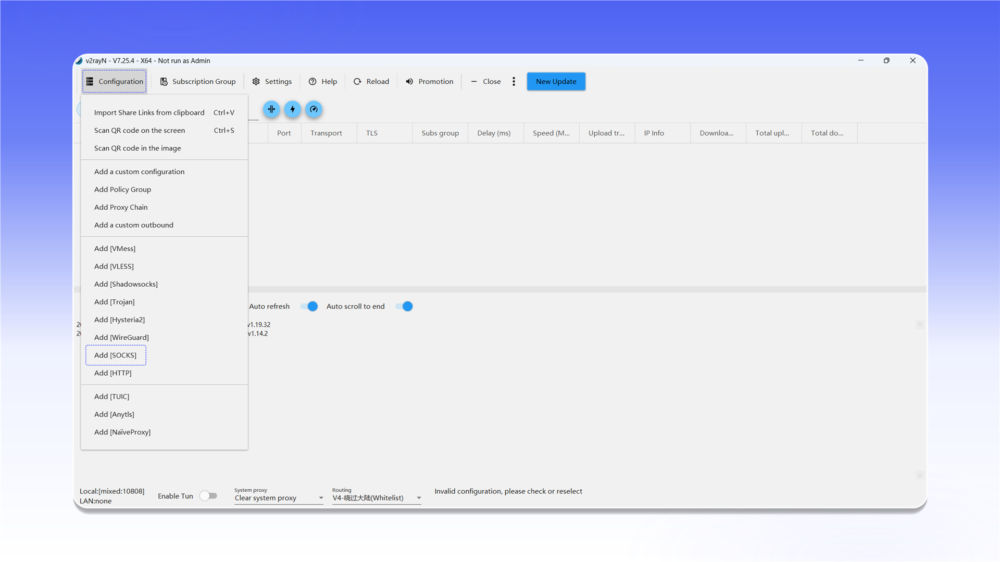
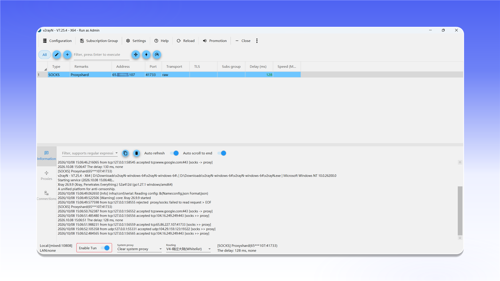

# v2rayN


v2rayN поддерживает проксирование TCP- и UDP-трафика в режиме TUN.


## Скачивание и запуск

Откройте [страницу последнего релиза v2rayN](https://github.com/2dust/v2rayN/releases/latest), скачайте `v2rayN-windows-64.zip`, распакуйте архив и запустите `v2rayN.exe` от имени администратора.

<figure>
  <picture>
    <source srcset="../../.gitbook/assets/v2rayn-github-download_black.png" media="(prefers-color-scheme: dark)">
    
  </picture>
</figure>

## Добавление SOCKS-сервера

Откройте меню `Configuration` и выберите `Add [SOCKS]`.

<figure>
  <picture>
    <source srcset="../../.gitbook/assets/v2rayn-menu-add-socks_black.png" media="(prefers-color-scheme: dark)">
    
  </picture>
</figure>

Заполните параметры подключения:

- `Alias (remarks)`: любое понятное название;
- `Address`: IP-адрес или домен прокси;
- `Port`: порт подключения;
- `User(Optional)`: логин;
- `Password(Optional)`: пароль.

Нажмите `Confirm`, чтобы сохранить профиль.

<figure>
  <picture>
    <source srcset="../../.gitbook/assets/v2rayn-socks-config-dialog_black.png" media="(prefers-color-scheme: dark)">
    
  </picture>
</figure>


Расположение данных подключения описано в [общей инструкции](../getting-started.md).


## Подключение

Выберите созданный сервер и проверьте задержку. Затем включите `Enable Tun` в нижней панели, чтобы направить системный трафик через прокси.

<figure>
  <picture>
    <source srcset="../../.gitbook/assets/v2rayn-enable-tun-mode_black.png" media="(prefers-color-scheme: dark)">
    
  </picture>
</figure>
