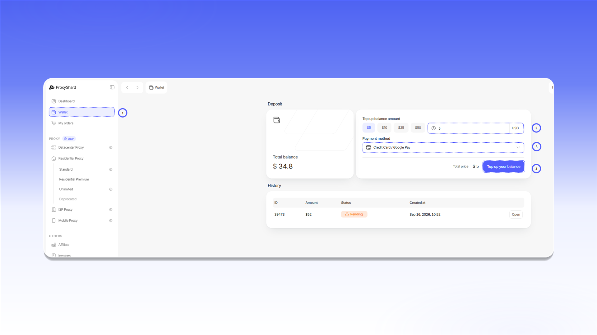

# Пополнение баланса

Баланс используется для покупки продуктов, продления заказов и оплаты дополнительного трафика. Минимальная сумма пополнения составляет **$5**.

Чтобы пополнить баланс:

1. Откройте раздел [`Wallet`](https://dashboard.proxyshard.com/en/wallet).
2. Укажите сумму в поле `Top up balance amount`.
3. Выберите способ оплаты в поле `Payment method`.
4. Нажмите `Top up your balance` и завершите оплату.

<figure>
  <picture>
    <source srcset="../.gitbook/assets/wallet-top-up-form_black.png" media="(prefers-color-scheme: dark)">
    
  </picture>
</figure>

В списке `Payment method` доступны:

* `Credit Card / Google Pay` - банковская карта или Google Pay. Платёж обрабатывается через Stripe.
* `Nowpayments (Crypto)` - оплата криптовалютой.
* `USDT TRC20` - отдельный способ оплаты для USDT в сети TRC20 (TRON).


Для оплаты USDT в сети TRC20 выберите именно `USDT TRC20`. Платёжная система взимает процентную комиссию, поэтому минимальная сумма такого платежа составляет **$21**.


В блоке `History` отображаются сумма, статус и дата каждого пополнения. Нажмите `Open`, чтобы открыть счет и при необходимости скачать его в формате PDF.
